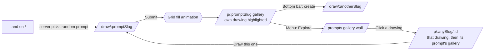
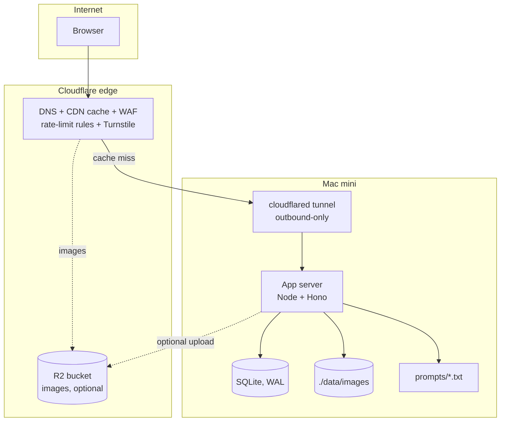

# Solcollab — Design Doc

**Status:** Draft v0.3 · 2026-10-17 (pen input treated like touch; contact section omitted for now)
**Owner:** Rebecca
**One-liner:** You get a short instruction, you draw it, and your drawing joins everyone else's version of the same instruction.

The name and the idea come from Sol LeWitt's wall drawings. LeWitt wrote instructions ("Lines in four directions, each in its own quarter…") and other people carried them out, so every version came out different. Solcollab does the same thing on the web: one prompt, many hands, one gallery wall.

---

## 1. Goals and non-goals

### Goals
- **Low friction:** someone can be drawing within 2 seconds of the page loading. No sign-up. A display name is optional.
- **A good drawing tool:** full color with opacity, adjustable brush size, undo, works with touch, pen, and mouse.
- **A gallery moment:** after you submit, you see your drawing among everyone else's for that prompt, with infinite scroll.
- **Easy prompts:** prompts live in plain text files in the repo. Adding one is a one-line PR.
- **Survives a Hacker News front page:** thousands of concurrent viewers, tens of submissions per second at peak, and no home-network exposure.
- **Operator controls:** close submissions (globally or per prompt), rate limit, hide or remove content, purge in bulk, and switch to read-only mode.
- **Starts on the Mac mini:** it runs there first, and the path to moving it off the mini is planned from day one.

### Non-goals (v1)
- User accounts, profiles, likes, or comments.
- Real-time collaborative drawing on a shared canvas. That might come later.

### Never
- **AI judging, scoring, or generation of drawings.** Every drawing is made and seen by people only. This is a permanent design rule, not a v1 deferral. (Automated *safety* checks for moderation, §8.3, are a separate question.)
- **Native mobile apps.** Solcollab is web-only. Phones and tablets get the full experience in the browser: a responsive layout, touch and pen input, and the full gallery.
- **User-submitted prompts.** Prompts are curated by us in the repo's prompt files (§4). There will be no "suggest a prompt" form.

---

## 2. User experience

### 2.1 Flow



### 2.2 Screens

| Route | Purpose | Notes |
|---|---|---|
| `/` | Entry point | Redirects (302) to `/draw/<random-slug>`. Each visit gets a fresh random prompt. The redirect is never cached. |
| `/draw/:slug` | Prompt and canvas | The prompt text is set large above the canvas. Toolbar: color with alpha, brush size, undo/redo, eraser, clear, and **background color** (starts white). Optional "sign it" name field. **Submit** button. A "skip / new prompt" link is also available. |
| `/p/:slug` | Gallery for one prompt on the current wall | Infinite-scroll grid of thumbnails, with a **Newest / Random** toggle (`?sort=new\|random`, default Newest). After a submission, the user's own drawing is pinned first and outlined. Clicking a tile opens a lightbox with the full-size drawing, the name, a relative time ("3 min ago"), and a **▶ Replay** button (§2.6). |
| `/prompts` | Explore | A Pinterest-style **gallery wall** of every drawing on the current wall, across all prompts. Only the images are shown: no prompt text, counts, or sort controls. Tiles come in a few tessellating sizes, in a mostly random order that leans toward newer drawings, with infinite scroll (§2.8). |
| `/p/:slug/:id` | One drawing, then its prompt | Opened by clicking a drawing on Explore. The chosen drawing is shown large at the top with its placard (wall, number, name, time); clicking it opens the lightbox for replay and sharing. Scrolling down reaches the normal `/p/:slug` gallery for the same prompt, with the chosen drawing left out of the grid so it isn't shown twice. Archived walls use `/w/:wall/p/:slug/:id`. |
| `/walls` | Past walls | List of archived walls ("Wall 1 · Oct–Dec 2026"), each with its date range, drawing count, and a mosaic. Opening one shows that wall's gallery wall (§2.8), with prompt galleries **read-only** at `/w/:wall/p/:slug` (§8.4). |
| `/admin` | Operator console | Not public. It sits behind Cloudflare Access or a Tailscale-only listener (§8.6). |

**Bottom navigation** (all pages, desktop and mobile):
1. **Solcollab** sits at the left edge.
2. A lowercase **create** SVG sits at the exact horizontal center. Its heavy letter paths have black outlines and a soft-grey fill; it opens a new prompt while avoiding completed prompts (§4.3).
3. A **hamburger** at the right opens Explore prompts, Past walls, and About & privacy. Prompt context and the wall label are folded into this menu. The menu dismisses on Escape or an outside click.

The fixed bottom bar respects mobile safe areas; content and the drawing canvas reserve room for it.

### 2.3 The canvas

- **Logical size:** a fixed 1000 × 1000 square. It is scaled with CSS to fit the viewport and rendered at `devicePixelRatio` for sharpness, so every drawing in the gallery has the same aspect ratio and composes like a grid of wall panels.
- **Input:** Pointer Events (`pointerdown/move/up`) with `setPointerCapture`. `getCoalescedEvents()` gives smooth lines. Pen input follows the same constant-width behavior as touch; device pressure is ignored. `touch-action: none` on the canvas stops the page from scrolling while you draw.
- **Strokes:** we record strokes as data (`{color, alpha, size, tool, points: [x, y, pressure, t][]}`, where `t` is ms since the stroke began) and render with quadratic-curve smoothing, or with the [perfect-freehand](https://github.com/steveruizok/perfect-freehand) library for smooth ink outlines. Storing stroke data makes undo/redo trivial (replay the stroke list) and powers the 5-second replay (§2.6).
- **Color:** a small curated palette (LeWitt primaries plus black, gray, and white) and a full picker: HSV square, hue slider, and an **opacity slider from 0 to 100%**. Show the swatch over a checkerboard so transparency is visible. Implemented with `<input type="color">` plus a custom alpha slider, or a tiny library such as [`vanilla-colorful`](https://github.com/web-padawan/vanilla-colorful) (2.7 kB, has an RGBA picker).
- **Brush size:** a slider from 1 to 80 px in logical units, with a live circular preview at the cursor.
- **Pen input:** treat pen tablets and styluses like regular touch. New points use full brush width regardless of reported pressure. There is no pressure toggle, tuning, calibration, or separate pen-tablet validation requirement. Existing stroke data remains replayable.
- **Background:** the user can pick the background color. It **starts white** (`#FFFFFF`). The background is opaque (the picker has no alpha slider), so every drawing is a solid panel on the gallery wall. Changing it is undoable like a stroke, and it is stored with the stroke data (`background: "#RRGGBB"`), so replays (§2.6) start from the right color.
- **Layers:** two canvases stacked: a background layer (a flat fill) and an ink layer for strokes. On submit, the two are flattened into one opaque PNG.
- **Eraser:** draws on the ink layer with `globalCompositeOperation = 'destination-out'`, so it reveals the chosen background instead of punching a hole through it.
- **Guardrails:** Submit stays disabled until there is at least one stroke. A soft cap of about 5,000 points keeps payloads bounded. Leaving the page with unsaved strokes triggers a `beforeunload` warning.
- **Accessibility:** the toolbar works with the keyboard (`[`/`]` for brush size, `Ctrl/Cmd+Z` for undo). The prompt and controls have proper labels.

### 2.4 The cheesy submit animation

We want this on purpose: a little silly, but well made. The tone is a gallery opening with a kazoo.

**Decision:** the submit animation is **Grid fill** (§2.5). The drawing breaks into a 10×10 mosaic and the tiles are carried to the gallery slot. v1 ships squares only, and other shapes come later through the pattern interface.

The steps every submit goes through:
1. On submit, freeze the canvas and capture it as an image (`canvas.toBlob`).
2. Fire the upload in parallel. The animation hides the latency.
3. **Grid fill** carries the drawing to the top-left gallery slot (§2.5).
4. **Hang:** once the tiles land, a burst of geometric confetti (squares, circles, and lines in the LeWitt primaries) pops out, and a small placard reads *"Wall 1 · Drawing #4,812 — by you"*. Confetti is about 40 lines of canvas code, or [canvas-confetti](https://github.com/catdad/canvas-confetti) with custom shapes.
5. Respect `prefers-reduced-motion` (§2.5.9).
6. If the upload fails, the pieces "fall off the wall" (§2.5.8), a retry button appears, and the strokes are kept in memory and in `sessionStorage`.

Concepts considered and not chosen: "shrink and spin" (a single View Transitions morph with a spring overshoot), "pinned up" (a pushpin stabs it onto a corkboard), and "Polaroid" (it shakes and develops).

### 2.5 Grid fill animation (detailed design)

This is the submit animation, steps 3–4 of §2.4.

#### 2.5.1 Concept

The animation acts out a LeWitt instruction. While it plays, a caption types out under the canvas in the site's monospace face:

> *Wall Drawing #4,812. The drawing is divided into 100 equal squares. Each square is carried to the wall and hung in order, left to right, top to bottom.*

The joke is that the whole thing is a bit too formal for what is happening, which is a doodle of a sad cat being carried off in 100 pieces. Each future shape pattern (§2.5.5) brings its own instruction text, so the caption is always true to what you're watching.

#### 2.5.2 Timeline

Total ≈ 2.4 s. A click, tap, or keypress anywhere skips to the final state.

| Phase | Time (ms) | What happens |
|---|---|---|
| **0. Rule** | 0–200 | Hairline grid lines draw across the frozen canvas, one direction then the other, like a drafter ruling a sheet. The caption starts typing. |
| **1. Cut** | 200–500 | The seams open. Each tile shrinks by ~3% around its own center, so a gap shows between tiles over a gray ground. |
| **2. Lift** | 500–1000 | Tiles pop up with a slight scale-up (1.05), a small random rotation ($\pm 12°$), and a shadow, and drift a few px outward from the drawing's center. The page underneath switches to the gallery (§2.5.3). |
| **3. Carry** | 1000–2000 | Tiles fly to their spot in the destination thumbnail along slightly curved paths, staggered by the ordering function (§2.5.6). Rotation eases back to 0°. |
| **4. Hang** | 2000–2400 | The last tile lands. The seams close, the overlay is swapped for the real `` thumbnail, and the frame snaps on. Then the placard and confetti from §2.4 step 4 appear. |

Each tile's own flight lasts ~450 ms. The phase 3 window is the stagger spread plus that flight time.

#### 2.5.3 Crossing from `/draw` to `/p/:slug`

The tiles have to stay on screen while the page underneath changes. The cross-document View Transitions API can only morph whole elements, not 100 independent pieces. So:

- **Make the draw → gallery step a client-side route change** (`history.pushState`) inside one document. The canvas page and the gallery are both rendered by the same front-end bundle.
- The tiles live on a **fixed, full-viewport overlay** (`position: fixed; inset: 0; pointer-events: none; z-index: top`) that survives the route change.
- **Destination slot:** the gallery renders the pinned "mine" slot first, as an empty placeholder of known size, *before* any gallery JSON arrives. The destination rectangle can be measured (`getBoundingClientRect()`) right after the route change, with no wait on the network.
- If the user scrolls or resizes mid-animation, re-measure the destination every frame. That is cheap, and it keeps the tiles aimed at the right place.
- Deep links and reloads of `/p/:slug` still work as normal server-rendered pages. Only the post-submit transition is client-side.

#### 2.5.4 Geometry

Let the source rectangle (the canvas on screen) be $S = (S_x, S_y, S_w, S_h)$ and the destination (the thumbnail slot) be $D = (D_x, D_y, D_w, D_h)$. Pieces are defined in **unit-square coordinates** $u, v \in [0,1]$ (§2.5.5), so one piece description maps to both places:

$$
p_S = (S_x + u\,S_w,\; S_y + v\,S_h), \qquad p_D = (D_x + u\,D_w,\; D_y + v\,D_h)
$$

For each piece we animate its centroid $c$ from $c_S$ to $c_D$, uniform scale from $1$ to $k = D_w / S_w$, and rotation from $\theta_0$ (random, set in the Lift phase) to $0$.

**Curved path:** a straight line looks mechanical. Each centroid follows a quadratic Bézier with a control point lifted perpendicular to the straight line:

$$
c(t) = (1-t)^2\,c_S + 2(1-t)t\,m + t^2\,c_D, \qquad m = \tfrac{1}{2}(c_S + c_D) + h\,\hat{n}
$$

Here $\hat{n}$ is the unit normal to $c_D - c_S$, and $h$ is a per-piece random height (say 5–15% of the distance), so the tiles fan out a little instead of moving as one block. Use $t = \text{ease}(\tau)$ where $\tau \in [0,1]$ is the piece's local progress. `easeInOutCubic` works for the carry. A small spring overshoot works on landing.

**Stagger:** with $N$ pieces, ordering rank $r_i \in \{0, \dots, N-1\}$, and spread $T$ (≈ 550 ms), piece $i$ starts carrying at:

$$
t_i = t_{\text{carry}} + \frac{r_i}{N-1}\,T
$$

#### 2.5.5 Pieces as shapes: the "shatter pattern" interface

Squares are just the first pattern. To make other shapes easy to add later, **the animation engine knows nothing about squares.** It takes a list of pieces, each with an outline in unit-square coordinates:

```ts
// web/src/shatter/types.ts
export interface Piece {
  /** Outline in unit-square coords (0..1). Used as a clip path. */
  path: Path2D;
  /** Polygon points for the path, kept for centroid, bounds and tests. Curves are flattened. */
  points: [number, number][];
  /** Centroid in unit coords — the pivot for rotation and the point that flies. */
  centroid: [number, number];
}

export interface ShatterPattern {
  name: string;                       // "grid", "triangles", "voronoi", ...
  /** The LeWitt-style caption; {n} is replaced with the piece count. */
  instruction: string;
  /** Must partition the unit square: no gaps, no overlaps. */
  generate(rng: () => number, opts: { density: number }): Piece[];
}
```

**Main rule: the pieces must partition the unit square.** The reassembled drawing then lines up exactly when the tiles land. A dev-mode check and unit tests enforce it (§2.5.9).

Pattern ideas, roughly in order of how easy they are:

| Pattern | Pieces | Instruction caption (draft) |
|---|---|---|
| **grid** (v1) | $n \times n$ squares, default $n = 10$ | "…divided into {n} equal squares…" |
| **bands** | Vertical or horizontal strips (LeWitt's line works) | "…cut into {n} vertical bands of equal width…" |
| **triangles** | Each grid square split on a diagonal, with the diagonals alternating direction | "…{n} triangles, each half of a square…" |
| **four directions** | Quadrants, each cut into strips at 0°, 45°, 90°, 135° (nods to *Wall Drawing #1, Lines in Four Directions*) | "…lines in four directions, each in its own quarter, cut along the lines…" |
| **arcs** | Concentric rings from a corner, cut into sectors | "…arcs from the corner, cut into {n} pieces…" |
| **hexagons** | A hex grid clipped to the square edges | "…{n} hexagons, the edges trimmed to fit…" |
| **shards** | Voronoi cells from random seeds ([`d3-delaunay`](https://github.com/d3/d3-delaunay), ~6 kB) | "…broken into {n} irregular pieces…" |
| **jigsaw** | A grid with bezier tabs and blanks. Maximally cheesy. | "…a puzzle of {n} pieces, completed by the wall…" |

Clipping to the unit square is the only hard part for hexagons and Voronoi. `d3-delaunay`'s `voronoi([0,0,1,1])` already clips to bounds, and a hex grid can be clipped with a simple polygon-rectangle intersection (Sutherland–Hodgman, ~30 lines).

**Choosing a pattern:**
- v1: always `grid`.
- Later: pick at random per submission, using an RNG seeded from a client-generated seed. The seed is sent with the upload and stored, so a "replay how it was hung" feature could reproduce the exact animation.
- Optionally, a prompt file can set a default in its front-matter (`# shatter: shards`). That fits whimsical prompts, while `lewitt.txt` could stick to grid, bands, and four directions.
- A `?shatter=hexagons` query param in dev builds forces a pattern.

#### 2.5.6 Ordering ("hung in order")

The order in which pieces fly is a separate, pluggable function: `order(pieces, rng) → rank[]`. That way any shape can be combined with any choreography, and the caption's last clause comes from the order:

| Order | Caption fragment |
|---|---|
| row-major | "…left to right, top to bottom" |
| column-major | "…top to bottom, left to right" |
| diagonal sweep | "…corner to corner" |
| spiral inward | "…from the edge, spiraling in" |
| distance from center | "…from the center outward" |
| random | "…in no particular order" |
| by ink (darkest tile first) | "…the heaviest pieces first" |

The "by ink" order uses the per-piece stats from §2.5.7.

#### 2.5.7 Rendering

**Recommended: one overlay `<canvas>` drawn on each frame with `requestAnimationFrame`.**
- Snapshot the drawing once as an `ImageBitmap` (`createImageBitmap(canvas)`).
- For each piece, each frame: `save()`, then translate, rotate, and scale around the centroid, then `clip(piece.path)` (scaled to the source size), `drawImage(bitmap, …)`, a 1px hairline `stroke(path)` for the tile edge, and `restore()`.
- About 100–400 clipped `drawImage` calls per frame is comfortable at 60 fps on modern phones. Every shape works the same way, because it's just a `Path2D`.
- Cap the overlay backing store at `devicePixelRatio ≤ 2`.

**Per-piece ink stats:** backgrounds are opaque (§2.3), so every piece is visible and every piece flies. There are no holes in the mosaic. Before the animation, downsample the **ink layer** (e.g. to 100×100 with `getImageData`) and compute the mean alpha per piece, which is how much ink each tile carries. The "by ink" order (§2.5.6) uses it. Optionally, pieces with no ink can fly slightly faster and flatter, so the inked tiles get the attention.

**Alternative: DOM tiles.** Use one `<div>` per piece with `background-image` set to the snapshot, `background-position` offset into it, `clip-path: path(...)` for the shape, and animate `transform` with the Web Animations API. The upside: transforms are composited on the GPU, and the browser does the work, with no draw loop. The downsides: 100+ composited layers is heavy on low-end phones, the per-frame destination re-measure is awkward, and complex `clip-path`s are slower. This is fine for a squares-only v1. The canvas approach scales better to the shapes roadmap, so it is the recommendation.

(WebGL would allow thousands of pieces and fancy effects, but it is overkill here.)

**Hairline seams on landing:** anti-aliasing along clipped edges leaves faint lines where pieces meet, even when the geometry is perfect. That doesn't matter, because at the end of the Hang phase the overlay is swapped for the real thumbnail `` (crossfade over 120 ms). The seams closing and vanishing reads as the drawing "fusing" back together, which is part of the effect.

#### 2.5.8 Interplay with the upload

The animation starts immediately and doesn't wait for the server, but the **Hang** phase needs the upload's result (the submission number for the placard and the final thumbnail URL):

- **Upload done before 2.0 s (the usual case):** play straight through. The thumbnail swaps in using the local snapshot (an object URL) and is replaced silently with the real URL.
- **Upload still pending:** after landing, the pieces hold in place, slightly separated, with a gentle bob (±2 px, staggered). The caption gets an ellipsis: *"…hung in order. Awaiting the curator…"*. This lasts up to 10 s, and then counts as a failure.
- **Upload failed / 429 / submissions closed:** the pieces "fall off the wall". Gravity is applied to each piece with a random spin and stagger, and they drop off the bottom of the viewport. The user is returned to `/draw/:slug` with their strokes restored and the error message (§2.4 step 7).

#### 2.5.9 Performance, accessibility, testing

- **Density by device:** default 10×10. Use 6×6 when `navigator.hardwareConcurrency ≤ 4` or the viewport is narrower than 500 px. If more than 5 of the last 10 frames took > 24 ms, skip ahead to the Hang phase.
- **Reduced motion:** with `prefers-reduced-motion: reduce`, the grid lines draw (phase 0), then the drawing crossfades straight to the gallery slot. There's no flying, spinning, or confetti. The caption is still shown.
- **Screen readers:** an `aria-live="polite"` region announces "Your drawing was added to the wall as Wall Drawing #4,812." The overlay itself is `aria-hidden`.
- **Dev harness:** a page at `/dev/shatter?pattern=grid&order=spiral&seed=42&n=10` with a slow-motion slider (0.1×–1×), a pause/scrub control, and a toggle that outlines each piece and numbers its rank. It's useful for designing new patterns, and fun to show off.
- **Pattern tests** (Vitest, no browser needed thanks to `points`):
  - The sum of the piece areas (shoelace formula) equals $1 \pm 10^{-6}$.
  - Every point is within $[0,1]^2$.
  - No overlap: rasterize all pieces into a 200×200 grid with point-in-polygon tests. Every cell must be covered exactly once, allowing for edge cells.
  - Same seed → same pieces (determinism, so replays are possible).

#### 2.5.10 Implementation size

About 400–600 lines of TypeScript and no dependencies for the grid, bands, and triangles patterns. `d3-delaunay` is added only when shards arrive. Files:

```
web/src/shatter/
  types.ts            # Piece, ShatterPattern, OrderFn
  engine.ts           # timeline, overlay canvas, rAF loop, skip/hold/fail states
  geometry.ts         # bezier path, easing, centroid, polygon clip
  patterns/grid.ts    # v1
  patterns/bands.ts   # later
  patterns/triangles.ts
  orders.ts           # row-major, spiral, by-ink, ...
  caption.ts          # assembles the instruction text from pattern + order
```

### 2.6 Stroke storage and the 5-second replay

Every submission stores its stroke data next to the image, so the lightbox can **replay how the drawing was made, condensed into exactly 5 seconds**, however long it actually took.

#### 2.6.1 What is stored
- The **final** stroke list, in drawing order: undone strokes are dropped, and eraser strokes are kept (they replay as erasing).
- The final background color. The replay starts from that color, not from white.
- Stored as `strokes.json.gz` beside `full.webp` / `thumb.webp`, with an immutable cache like the images.
- Typical size is 5–50 KB gzipped, against 30–120 KB for the full image. That is the "~2× storage" mentioned earlier at the high end, and usually less.

#### 2.6.2 Config switch
- Server config `STORE_STROKES` (env var, default `true`), exposed to the client in `GET /api/config`.
- When it's **off**: the client doesn't send strokes, the server discards any it receives, and the ▶ Replay button is hidden. Strokes already stored stay on disk until `npm run ops -- purge-strokes` removes them.
- It's a config value and not a runtime admin switch, because it is a storage policy rather than an incident control.

#### 2.6.3 Time compression

Real timing is kept *within* strokes, so you still see fast flicks and slow careful lines. Pauses *between* strokes are squeezed. With $n$ strokes of real durations $d_1, \dots, d_n$ and a total budget $B = 5000$ ms:

- Reserve a gap budget $G = \min(0.15B,\; 60\,(n-1))$ ms, split evenly across the $n-1$ gaps between strokes. A short pause reads as "pen lifted".
- Each stroke gets playback time proportional to its real duration, with a floor so single dots don't vanish:

$$
p_i = \max\!\left(p_{\min},\; \frac{d_i}{\sum_j d_j}\,(B - G)\right), \qquad p_{\min} = 16\ \text{ms}
$$

  Then renormalize so that $\sum_i p_i + G = B$ exactly.
- Within stroke $i$, a point with real timestamp $t$ plays at $\frac{t}{d_i}\,p_i$ after the stroke's start.
- Playback runs on `requestAnimationFrame` into the lightbox canvas. Each frame draws every point whose playback time has passed, with the same brush renderer as the editor, so the replay's last frame matches the image pixel for pixel.
- Controls: ▶ / ❚❚, and click to restart. Replay respects `prefers-reduced-motion` and doesn't autoplay in that case.

#### 2.6.4 Validation (server)

Stroke data is user input, so it is checked like the image:
- Gzip ≤ 200 KB. Decompress with a 2 MB output limit to guard against zip bombs.
- Schema check (e.g. with `zod`): ≤ 1,000 strokes, ≤ 5,000 points total, coordinates within $[0, 1000]$, size 1–80, colors `#RRGGBB`, alpha within $[0, 1]$, timestamps non-decreasing, and $d_i \le 10$ min.
- If the strokes are invalid, the submission is **still accepted**, with `strokes_key = NULL` and no replay button. Strokes are a nice-to-have, and a broken replay shouldn't cost someone their drawing.
- *Future option:* rasterize the image on the server from the strokes (e.g. with `@napi-rs/canvas`) instead of accepting a PNG at all. That guarantees the image and replay match, and removes image upload as an attack surface. It needs the brush renderer shared between client and server, so it is not v1.

### 2.7 Gallery order: Newest and Random

Each gallery has a **Newest / Random** toggle. Both must stay cacheable at the edge (§9).

- **Newest** (default): keyset pagination on the ULID, as in §6.
- **Random:** every submission gets a random `shuffle_key` (a 32-bit integer) when it is created. A random view is the gallery sorted by `shuffle_key`, **starting at a random point and wrapping around**:
  - On page load, the client picks a bucket $b \in \{0, \dots, 63\}$. The view starts at `shuffle_key ≥ b·2^{26}` and continues to the end, then wraps around from 0 back up to the start.
  - The cursor is `r.<b>.<last_shuffle_key>.<wrapped>`.
  - There are only 64 possible sequences per gallery, so each page is shared by everyone who drew the same bucket and caches well (`s-maxage=60`). It still feels random from visit to visit.
  - A **🔀 Shuffle again** button picks a new bucket.
- Adjacent buckets show rotations of the same underlying order, not fully independent shuffles. That is fine for browsing. If it ever feels repetitive, add a second `shuffle_key2` and alternate between them.
- The post-submit view is always **Newest**, with your drawing pinned first.

### 2.8 Explore: the gallery wall

`/prompts` (and `/w/:wall` for an archived wall) is a single wall of drawings from every prompt, like a Pinterest board, but because every drawing is square the pieces lock together on a grid instead of hanging in ragged columns.

**Layout.** The outer grid has 5 columns on wide screens, then 4, 3, and 2 as the screen narrows (2 at phone width). One column-wide square is a **standard** cell. The client reads drawings in order and picks a shape for the next block, so drawings of different sizes sit next to each other:

| Block | Share of blocks | Fills | Drawings |
|---|---|---|---|
| Single | ~58% | 1 standard cell | 1 at full size |
| Large | ~12% | 2 × 2 standard cells | 1 at double size |
| Halves | ~14% | 1 standard cell | 4 at ½ size, in a 2 × 2 grid |
| Corner | ~10% | 1 standard cell | 1 at ⅔ size in a random corner, wrapped by 5 at ⅓ size |
| Thirds | ~6% | 1 standard cell | 9 at ⅓ size, in a 3 × 3 grid |

- Clusters (halves, corner, thirds) are split on a 6 × 6 sub-grid, so ½ (3 units), ⅓ (2 units), and ⅔ (4 units) always tile exactly. For example, a row of three ⅓-size drawings lines up with the width of one standard drawing.
- The outer grid uses `grid-auto-flow: dense`, so later cells fill the holes a Large block leaves at the end of a row. The wall has no gaps, except possibly in the last row while more pages are loading.
- Block shapes come from a small seeded PRNG (the same seed as the order below), so a given seed always gives the same layout.
- If a cluster needs more drawings than are loaded, it waits for the next page. On the final page, leftover drawings become singles.
- Images use `srcset` (320 px thumb, 1000 px full), so Large tiles stay sharp and ⅓-size tiles stay light.

**Order: mostly random, slightly newer-first.** `GET /api/submissions?seed=` orders the wall's visible drawings by

$$\text{score} = (\texttt{shuffle\_key} \oplus \text{seed}) + \text{recency} \cdot 0.4 \cdot 2^{32}$$

where recency ∈ [0, 1] is how far through the wall's lifetime the drawing was made (from `opened_at` to `closed_at`, or to the time of the first page for an open wall). XOR-ing with a per-visit seed gives each visit its own shuffle, not just a rotation of one fixed order. The recency bonus is at most 40% of the random range, so the newest drawings tend toward the top, but old drawings still show up early.

- The client picks a 32-bit seed on each fresh visit and keeps it in `history.state`, so **Back** from a drawing returns to the same order.
- The cursor is `<seed>.<anchor>.<last score>~<last id>`. The anchor time is fixed at the first page, so scores don't drift while you scroll. The score is computed in SQL, so this is a scan of the wall's visible rows, which is fine at wall scale (thousands of rows).
- Clicking any tile goes to `/p/:slug/:id` (§2.2).

---

## 3. Architecture

### 3.1 Overview



Key properties:
- **No inbound ports are opened on the home router.** `cloudflared` makes an outbound connection to Cloudflare, and all traffic arrives through it (§7).
- **Most traffic never reaches the mini.** Images are immutable and cached at the edge forever. Gallery JSON is cached briefly (5–30 s). The JS/CSS bundle is static and fingerprinted.
- **A single process with a single SQLite file.** Simple to back up, simple to move to a VPS later.

### 3.2 Stack (recommended)

| Layer | Choice | Why |
|---|---|---|
| Front end | **Vanilla TypeScript + Vite**, with no framework or at most [Preact](https://preactjs.com/) | The canvas is imperative anyway, and the pages are simple. The bundle is under 30 kB, so it loads fast on HN traffic. |
| Server | **Node 22 + [Hono](https://hono.dev/)** | Tiny and fast. Hono also runs on Cloudflare Workers, so the "go fully serverless" migration (§7.2 option D) is a port, not a rewrite. |
| DB | **SQLite** in WAL mode, via `better-sqlite3` (or `node:sqlite`) | Handles thousands of reads per second and hundreds of writes per second on a Mac mini. One file. There is no DB server to secure. |
| Images | **`sharp`** to re-encode → WebP stored on disk (or R2) | Re-encoding strips anything malicious or odd from uploads and normalizes the size. |
| Process mgmt | `launchd` plist (or Docker via OrbStack/Colima) | Restarts on crash and at boot. |
| Backups | [Litestream](https://litestream.io/) → R2/S3 | Continuous SQLite replication, so we can restore to any point in time. |

**Alternatives considered:**
- *Python (FastAPI) + SQLite:* also fine. Image handling is equally easy with Pillow. Node won because the front and back ends share a language and Hono makes the Workers migration easy.
- *Go single binary:* the best raw efficiency and the easiest deploy (one file). It would be a good choice if we expect to stay self-hosted forever. It's a little slower to iterate on for UI-adjacent work.
- *Next.js / SvelteKit:* more machinery than this app needs. We'd have to fight SSR and caching to get the simple caching model in §6.
- *Supabase / Firebase:* fast to start, but it adds vendor lock-in and its own rate limiting and abuse surface. The point of the Mac mini is to own the stack.

### 3.3 Repo layout

```
solcollab/
  prompts/                 # human-editable prompt files (§4)
    lewitt.txt
    whimsical.txt
    architectural.txt
  web/                     # Vite front end
    src/canvas/  src/gallery/  src/shatter/  src/replay/  src/ui/
  server/
    src/routes/  src/db/  src/prompts.ts  src/ratelimit.ts  src/admin/
    migrations/
  data/                    # gitignored: solcollab.db, images/
  ops/
    cloudflared/config.yml
    launchd/com.solcollab.app.plist
    litestream.yml
  scripts/                 # purge, export, close-submissions CLI
  docs/DESIGN.md
```

---

## 4. Prompts

### 4.1 File format

Prompts are plain-text files in `prompts/`, one prompt per line. Lines starting with `#` are comments, and blank lines are ignored. Optional front-matter at the top of a file sets the weight.

```text
# prompts/lewitt.txt
# weight: 2
# Instructions in the spirit of Sol LeWitt's wall drawings.

Lines in four directions, each in its own quarter.
A circle, a square and a triangle, drawn without lifting your pen.
Ten thousand lines, none longer than your thumb.
A grid, with one square that refuses.
```

```text
# prompts/whimsical.txt
# weight: 1

A cat who has just been told bad news.
The view from inside a teapot.
Your commute, drawn as a map by a pigeon.
```

### 4.2 Identity and sync
- Each prompt's **slug** comes from its text (`"A grid, with one square that refuses."` → `a-grid-with-one-square-that-refuses`). URLs are human-readable and shareable. If two slugs collide, the second one gets `-2`.
- At startup, and on `SIGHUP` or the admin "reload prompts" button, the server parses all files and **upserts** the prompts into a `prompts` table.
- **Removing a line does not delete the prompt.** It is marked `active = 0`: it stops being served for new drawings, but its gallery stays browsable. **Editing a line creates a new prompt**, because the slug changes. That is intentional, since the drawings were made for the old wording.
- If you want to fix a typo without splitting a gallery, an optional `slug-override` syntax handles it: `A cat who has just been told bad news. {slug: sad-cat}`.
- CI lint: no duplicate lines, at most 140 characters, and no trailing whitespace.

### 4.3 Random selection
1. Pick a **file** at random, weighted by its `weight` (default 1). This keeps a large file from crowding out a small curated one.
2. Pick an **active prompt** uniformly at random within that file.
3. **Avoid repeats:** the client keeps the last ~50 completed slugs in `localStorage` and sends them as a hint (`?exclude=`, capped in size). The server excludes them when it can.
4. *(Optional, later):* add a slight bias toward prompts with few submissions so new prompts fill up faster ("cold-start boost").

---

## 5. Data model

```sql
CREATE TABLE walls (                           -- periodic archived "seasons" (§8.4)
  id           INTEGER PRIMARY KEY,            -- 1, 2, 3…
  title        TEXT NOT NULL,                  -- "Wall 1"
  opened_at    INTEGER NOT NULL,
  closed_at    INTEGER                         -- NULL = the current wall (exactly one)
);

CREATE TABLE prompts (
  slug         TEXT PRIMARY KEY,
  text         TEXT NOT NULL,
  source_file  TEXT NOT NULL,
  active       INTEGER NOT NULL DEFAULT 1,     -- present in files?
  accepting    INTEGER NOT NULL DEFAULT 1,     -- per-prompt submission switch
  created_at   INTEGER NOT NULL
);

CREATE TABLE wall_prompt_counts (              -- denormalized for /prompts and "Drawing #N"
  wall_id      INTEGER NOT NULL REFERENCES walls(id),
  prompt_slug  TEXT NOT NULL REFERENCES prompts(slug),
  count        INTEGER NOT NULL DEFAULT 0,
  PRIMARY KEY (wall_id, prompt_slug)
);

CREATE TABLE submissions (
  id           TEXT PRIMARY KEY,               -- ULID: time-sortable, unguessable
  wall_id      INTEGER NOT NULL REFERENCES walls(id),
  prompt_slug  TEXT NOT NULL REFERENCES prompts(slug),
  number       INTEGER NOT NULL,               -- per (wall, prompt) "Drawing #N"
  shuffle_key  INTEGER NOT NULL,               -- random 32-bit, for Random order (§2.7)
  background   TEXT NOT NULL DEFAULT '#FFFFFF',
  display_name TEXT,                           -- optional, ≤ 32 chars, filtered
  input_type   TEXT,                           -- pen | touch | mouse (dominant), anonymous usage signal (§12 q7)
  image_key    TEXT NOT NULL,                  -- e.g. 01J…/full.webp, 01J…/thumb.webp
  strokes_key  TEXT,                           -- gzipped stroke JSON for replay; NULL if STORE_STROKES=false or invalid
  status       TEXT NOT NULL DEFAULT 'visible',-- visible | hidden | deleted
  report_count INTEGER NOT NULL DEFAULT 0,
  ip_hash      TEXT NOT NULL,                  -- HMAC(ip, daily-rotating salt)
  device_id    TEXT NOT NULL,                  -- random anon cookie
  created_at   INTEGER NOT NULL
);
CREATE INDEX idx_sub_gallery ON submissions(wall_id, prompt_slug, status, id DESC);
CREATE INDEX idx_sub_random  ON submissions(wall_id, prompt_slug, status, shuffle_key);
CREATE INDEX idx_sub_ip      ON submissions(ip_hash, created_at);

CREATE TABLE reports (
  submission_id TEXT NOT NULL REFERENCES submissions(id),
  device_id     TEXT NOT NULL,
  reason        TEXT,
  created_at    INTEGER NOT NULL,
  PRIMARY KEY (submission_id, device_id)       -- one report per device
);

CREATE TABLE settings (                        -- runtime switches (§8)
  key   TEXT PRIMARY KEY,
  value TEXT NOT NULL
);
-- keys: submissions_open, read_only, global_daily_cap, auto_hide_report_threshold, banner_message
```

**Files:** each submission has up to three:
- `full.webp`: 1000×1000, q≈90, opaque. Typically 30–120 KB.
- `thumb.webp`: 320×320, q≈80. Typically 8–20 KB.
- `strokes.json.gz`: the replay data (§2.6), when stroke storage is on. Typically 5–50 KB.

Keys are content-addressed under the ULID and never change. That allows `Cache-Control: public, max-age=31536000, immutable`.

---

## 6. API

All responses are JSON. Writes require a valid Turnstile token (§8.2) and pass through the rate limiter.

| Method & path | Description | Caching |
|---|---|---|
| `GET /api/config` | `{store_strokes, submissions_open, current_wall, banner_message}` | `s-maxage=30` |
| `GET /api/prompt/random?exclude=a,b,c` | Returns `{slug, text}` | `no-store` |
| `GET /api/prompts?wall=&cursor=&sort=active\|new` | Paginated prompt index with counts and 4 recent thumb URLs. `wall` defaults to the current wall. | `s-maxage=60` |
| `GET /api/prompts/:slug` | Prompt metadata and `accepting` flag | `s-maxage=60` |
| `GET /api/prompts/:slug/submissions?wall=&sort=new\|random&cursor=&limit=30` | Gallery page. `new`: **keyset pagination** (`WHERE id < :cursor ORDER BY id DESC`). `random`: the bucketed wrap-around order of §2.7. | new: `s-maxage=10, stale-while-revalidate=60`. random: `s-maxage=60`. Past walls: `s-maxage=86400`. |
| `GET /api/submissions?wall=&seed=&cursor=&limit=48` | Explore wall page: every visible drawing on a wall, across prompts, in the seeded, newer-leaning random order of §2.8. `limit` ≤ 96. | `s-maxage=60, stale-while-revalidate=60`. Past walls: `s-maxage=86400`. |
| `GET /api/walls` | List of walls with date ranges and counts | `s-maxage=300` |
| `GET /api/submissions/:id` | Single drawing, for the lightbox or a shared link. Includes `strokes_url` when a replay exists. | `s-maxage=300` |
| `POST /api/submissions` | `multipart/form-data`: `prompt_slug`, `image` (PNG ≤ 1.5 MB), `background`, `strokes` (gzip JSON ≤ 200 KB; omitted when `store_strokes` is off), `display_name`, `turnstile_token` → `{id, thumb_url, full_url, wall, number}` | — |
| `POST /api/submissions/:id/report` | `{reason}` | — |
| `GET /img/:key` | Image bytes, served from disk (or a redirect to the R2 public URL) | `immutable`, 1 year |

**Why keyset pagination:** offset pagination gets slower the deeper you scroll, and it shifts when new drawings arrive mid-scroll. A ULID cursor is stable and O(log n).

**"Your drawing first":** after submitting, the client navigates to `/p/:slug?mine=<id>`. The gallery fetches that one drawing and pins it at the top, then streams the normal pages and skips that id. The cached gallery JSON stays identical for everyone, so the edge cache still works.

**Upload pipeline (server):**
1. Cheap checks first: settings switches, per-prompt `accepting`, rate limit, Turnstile verify, and `Content-Length` ≤ 1.5 MB.
2. Decode with `sharp`. Reject the upload unless it is a PNG of exactly 1000×1000 (check magic bytes and dimensions). Flatten any stray alpha onto `background`. Reject blank drawings, meaning an image that is one uniform color (channel standard deviation ≈ 0).
3. If `STORE_STROKES` is on, validate the strokes (§2.6.4). Invalid strokes are dropped, not fatal.
4. Re-encode to `full.webp` and `thumb.webp`, write them and `strokes.json.gz` atomically (temp file + rename) or upload them to R2.
5. In a single transaction: increment `wall_prompt_counts` for (current wall, prompt), insert the row with that count as `number`, and generate a random `shuffle_key`.
6. Return the wall and number for the placard ("Wall 1 · Drawing #412").

---

## 7. Hosting

### 7.1 Local (current plan)

We stay local-only until we decide to go public. Friends on the home network or on Tailscale can try it in the meantime (option B below, without Funnel, is enough for that).

- `npm run dev`: Vite dev server plus the Hono server, at `http://localhost:5173`.
- `npm run start`: production build. Hono serves `web/dist` statically, plus the API on `127.0.0.1:8787`. **Bind to loopback only.** Nothing on the LAN can reach it directly, and the tunnel connects locally.
- Run it as a **launchd** service under a dedicated, non-admin macOS user (`_solcollab`), with `data/` owned by that user. Alternatively, run it in a container (OrbStack or Colima) for better isolation from the rest of the Mac.
- Mac mini settings: *Prevent automatic sleeping* on, *Start up automatically after a power failure* on, automatic security updates on, FileVault on, and the macOS firewall on with stealth mode.

### 7.2 Going online without exposing the home network

> **Domain: placeholder for now.** We host locally (§7.1) for a while, with no public hostname. The planned domain is **`twolinescrossing.art`**. Until it is registered and added to Cloudflare, configs and this doc use the placeholder `{{DOMAIN}}` (one `PUBLIC_DOMAIN` env var in the app). Going online is a config change, not a code change.

The goal is **no router port forwarding and no public IP exposure**. All options below except D keep the mini as origin.

| Option | How it works | Pros | Cons | Cost |
|---|---|---|---|---|
| **A. Cloudflare Tunnel** ⭐ recommended | `cloudflared` on the mini makes an outbound-only connection. Cloudflare serves `{{DOMAIN}}` and forwards to `localhost:8787`. | Home IP stays hidden. Free CDN caching, WAF, rate limiting, and Turnstile are all on the same platform. Cloudflare Access can protect `/admin`. DDoS absorption. | Your traffic terminates TLS at Cloudflare, so they see it. You need a domain on Cloudflare DNS. Home upload bandwidth still serves cache misses. | Free (domain ≈ $10/yr) |
| **B. Tailscale Funnel** | Exposes a local port at `https://<machine>.<tailnet>.ts.net` via Tailscale's relays. | Very easy. No domain needed. Pairs nicely with Tailscale-only admin access. | No CDN, cache, WAF, or rate limiting in front, so every request hits the mini. Bandwidth limits apply, and the hostname is fixed. Fine for a friends-only beta, **not for HN**. | Free |
| **C. ngrok / similar** | The same tunnel idea as A. | Quick demos. | Rate limiting, custom domains, and traffic-policy features are on paid tiers. Less of an edge-cache story. | Free → ~$8–20/mo |
| **D. Move off the mini** | Deploy the same container to **Fly.io** or a **Hetzner/DigitalOcean VPS** (~$5/mo), still behind Cloudflare. Or go fully serverless: **Cloudflare Workers + D1 + R2** (Hono runs there natively). | The home network is completely out of the picture. Better uptime. A VPS keeps the SQLite + disk model as is. Workers scales to anything. | A small monthly cost. Workers means swapping `better-sqlite3` → D1 and disk → R2. Doable thanks to Hono, but it is a migration. | $0–10/mo |
| **E. Hybrid** (good middle step) | The mini runs the API and DB. **Images go to Cloudflare R2** behind a public custom domain (`img.{{DOMAIN}}`). | Image bandwidth, which is 95%+ of bytes, leaves the home uplink entirely. R2 has **no egress fees**. | One more moving part (an R2 key on the mini). | Pennies |

**Recommendation:** start with **A** (Tunnel) on day one. Add **E** (images on R2) before posting anywhere public. Keep **D** (VPS or Workers) as the "it's really taking off" or "I need my Mac mini back" escape hatch. The code should treat storage as an interface (`LocalDiskStore | R2Store`) from the start, so E and D are config changes.

**Hardening checklist when using a tunnel:**
- The app listens on `127.0.0.1` only. `cloudflared` runs as its own user. The router has no port forwards and UPnP is off.
- Put the mini on a **guest VLAN or isolated network** if the router supports it, so a compromised app can't reach other home devices. Even a cheap travel router in front of the mini gives you this.
- Use a dedicated Cloudflare API token scoped to this one zone. Never use a global key.
- Keep only the minimum needed on the box: no personal files or SSH keys in the service user's home.
- `cloudflared` ingress rules map only the one hostname, and end with a catch-all `http_status:404`.

```yaml
# ops/cloudflared/config.yml
tunnel: solcollab
credentials-file: /Users/_solcollab/.cloudflared/solcollab.json
ingress:
  - hostname: {{DOMAIN}}
    service: http://127.0.0.1:8787
  - service: http_status:404
```

### 7.3 Traffic estimate (HN front page)

HN front page traffic is roughly 10–50k unique visitors over ~12 hours, peaking at maybe 20–50 page views per second. Assume a 20% draw rate. That gives a peak write rate on the order of $50 \times 0.2 \approx 10$ submissions/s, which is trivial for SQLite + `sharp` (a ~20 ms encode per image, run on a worker pool).

The real constraint is **bandwidth**. One gallery screen ≈ 30 thumbnails × 15 KB ≈ 450 KB. At 50 views/s that is $50 \times 0.45\,\text{MB} \approx 22\,\text{MB/s} \approx 180\,\text{Mbit/s}$, more than most home upload links. **This is why images must be served from the edge cache or R2 and not from the mini.** With a ~95% CDN hit rate, the mini only sees a few Mbit/s.

Load-test before launch with [k6](https://k6.io/) or `oha`: 200 rps of gallery reads plus 10 rps of uploads, against the tunnel.

---

## 8. Operations: closing, rate limiting, moderation, cleanup

The controls are layered, so each layer catches what the one before it misses.

### 8.1 Switches (runtime, no deploy needed)

Stored in the `settings` table, toggled from `/admin` or the CLI (`npm run ops -- close-submissions`):

| Switch | Effect |
|---|---|
| `submissions_open = false` | `POST /api/submissions` → 503 with a friendly message. The canvas page shows *"The wall is closed for now. Browse the galleries →"*. Galleries keep working. |
| `prompts.accepting = 0` (per prompt) | Closes one prompt. For example, freeze a gallery that has become "complete" so it stays a finished piece. |
| `read_only = true` | Every write rejected, including reports. Use it during migrations or incidents. |
| `global_daily_cap = N` | Automatically closes submissions after N per UTC day. A safety valve against storage or abuse blowups. |
| `banner_message` | A site-wide notice, e.g. "We're on HN! Galleries may lag a few seconds." |

**Edge-level kill switch:** a pre-made but disabled Cloudflare WAF custom rule, `http.request.method eq "POST"` → Block (or Managed Challenge). Flipping it on stops all writes at the edge even if the mini is struggling. Using the dashboard or API takes ~10 seconds and doesn't depend on the app being healthy.

**Scheduled windows (optional):** the `settings` table can hold `open_from` / `open_until` timestamps for "the wall is open this weekend only" events.

### 8.2 Rate limiting and bot defense

| Layer | Mechanism | Suggested starting values |
|---|---|---|
| **Edge (Cloudflare)** | Rate limiting rule on `POST /api/submissions` per IP. *Free-plan limits on rule count and window length change over time and third-party sources disagree, so check the dashboard. The Pro plan ($20–25/mo) gives more rules and longer windows if needed.* | e.g. 10 req / 10 s → block 10 s on Free. On Pro: 5/min. |
| **Edge** | **Turnstile** (free CAPTCHA alternative), invisible/managed mode, required on submit and report | Validates server-side with `siteverify`. |
| **Edge** | Bot Fight Mode and WAF managed rules on | — |
| **App** | Token bucket per `ip_hash` **and** per `device_id` (in-memory LRU; SQLite-backed if we run several processes) | 1 submission / 20 s, 20 / hour, 100 / day per IP |
| **App** | Per-prompt flood guard | If one prompt gets > 60 submissions in a minute, add a challenge or a slowdown just for that prompt. |
| **App** | Global cap (above) | e.g. 20,000 / day |
| **App** | Payload validation | 1000×1000 PNG only, ≤ 1.5 MB, not blank. Display name ≤ 32 chars, Unicode-normalized, passed through a profanity/slur list (e.g. [`obscenity`](https://github.com/jo3-l/obscenity)), with zero-width and RTL-override characters stripped. |

Behind Cloudflare, the real client IP comes from the `CF-Connecting-IP` header. Trust it **only** because the app is reachable solely through the tunnel. That is one more reason to bind to loopback.

**IP privacy:** store `HMAC-SHA256(ip, salt)` where the salt rotates daily. Same-day rate limiting and bulk purges still work, and raw IPs are never stored.

### 8.3 Moderation (post-hoc and reports)

- Drawings go live immediately.
- Every lightbox has a **Report** button (one report per device, Turnstile-gated).
- **Auto-hide:** when `report_count ≥ auto_hide_report_threshold` (default 3), the drawing is set to `status = hidden` automatically and queued for review. A drawing that's hidden by mistake can be restored with one click.
- **Admin queue** (`/admin`): reported items sorted by count. Actions: *Restore*, *Hide*, *Delete* (soft delete, file kept for 30 days), and *Ban device / IP-hash* (24 h, 7 d, or forever).
- Hiding or deleting **purges the Cloudflare cache** for that drawing's image URLs and the gallery's first pages via the Cloudflare API, so removed content disappears within seconds.
- *Future option:* an automated NSFW image classifier at upload (e.g. a small ONNX model run locally). It is **allowed for safety only**: it may flag drawings into the human review queue, and must never block, score, rank, or otherwise judge drawings (§1, "Never").

### 8.4 Cleanup ("clean out the wall")

A CLI script (`scripts/ops.ts`) mirrors the admin buttons:

```bash
npm run ops -- close-submissions                  # global switch off
npm run ops -- open-submissions
npm run ops -- close-prompt <slug>
npm run ops -- purge --prompt <slug>              # hide/delete all drawings for one prompt
npm run ops -- purge --since "2026-10-20T14:00Z"  # e.g. after a spam wave
npm run ops -- purge --ip-hash <hash> | --device <id>
npm run ops -- new-wall --title "Wall 2"          # close the current wall, open the next (see below)
npm run ops -- export-wall 1 --out ./archive/wall-1  # static snapshot: JSON + images + strokes
npm run ops -- purge-strokes [--wall 1]           # remove stored replay data (e.g. after turning STORE_STROKES off)
npm run ops -- gc                                 # hard-delete files of soft-deleted rows > 30 days old
```

#### Walls (periodic archived seasons)

Solcollab runs in **walls**: periods of a few weeks to a few months. Each is a fresh, empty set of galleries for the same prompts. Old walls stay browsable, read-only, at `/walls` and `/w/:wall/p/:slug`.

`new-wall` does the following in one step:
1. Makes a fresh backup (Litestream snapshot plus an image sync).
2. Sets `closed_at` on the current wall. Its galleries become read-only, and their API responses switch to long cache lifetimes, since they'll never change again.
3. Inserts the next wall row, which becomes the current wall. Every prompt's gallery starts empty, and "Drawing #N" numbering restarts at 1.
4. Purges the cached `/api/config` and the current-wall gallery pages.

Cadence is manual by default: you run `new-wall` when a wall feels full or for an event. The optional scheduled-windows feature (§8.1) can automate it ("a new wall on the first of each quarter"). A wall can also start with a new prompt file set: `new-wall --prompts lewitt,architectural` limits which files are served on it.

`export-wall` writes a static, self-contained snapshot. It is an extra copy for the long term (it could be put on R2 as a plain static site if the app is ever shut down), not a requirement for viewing old walls.

There is deliberately **no "wipe everything" command**. Hiding content is `purge`, and starting fresh is `new-wall`. Real deletion is only through `gc` of soft-deleted rows.

### 8.5 Backups and recovery
- **Litestream** replicates SQLite continuously to R2/S3.
- Images: a nightly `rclone sync` of `data/images` to R2. This isn't needed once images live in R2 (option E).
- Practice a restore before launch.

### 8.6 Admin access
- Put `/admin` and `/api/admin/*` behind **Cloudflare Access** (Zero Trust free tier, up to 50 users) with email one-time-PIN or Google login, **and** check the `Cf-Access-Jwt-Assertion` JWT in the app (defense in depth).
- Alternative: serve the admin UI on a second listener bound to the Mac's **Tailscale** IP only. The admin page is then not on the public internet at all.

### 8.7 Observability
- Structured JSON logs (pino) rotated with `newsyslog`.
- A `/healthz` endpoint, checked by a free uptime monitor (e.g. Better Stack or UptimeRobot) through the public hostname, so it also tests the tunnel.
- Cloudflare analytics for traffic and cache-hit ratio. A small `/admin/stats` page for submissions per minute, top prompts, and rate-limit rejections.
- A push alert (ntfy.sh or email) when submissions per minute exceed a threshold. That usually means you've been posted somewhere, or you're being spammed.

---

## 9. Performance and caching

- **Static assets:** fingerprinted filenames with `immutable` caching. The total initial JS is under 30 kB gzipped. Fonts are self-hosted and subset.
- **Images:** `immutable` with a 1-year max-age, served from the edge or R2. Thumbnails use `loading="lazy"` and `decoding="async"`, with an explicit `width`/`height` so the layout doesn't shift.
- **Gallery JSON:** `s-maxage=10, stale-while-revalidate=60`. Under a spike, the mini sees at most ~1 request per 10 s per gallery page, whatever the traffic. A Cloudflare **Cache Rule** is needed to cache `/api/*` JSON, since Cloudflare doesn't cache JSON by default.
- **Infinite scroll:** an `IntersectionObserver` sentinel prefetches the next page when the user is ~1.5 screens away. Once more than ~600 tiles are mounted, recycle DOM nodes (simple windowing) to keep mobile memory in check.
- **Server:** `sharp` runs with limited concurrency (a queue of 4) so an upload burst can't starve reads. SQLite settings: `PRAGMA journal_mode=WAL; synchronous=NORMAL; busy_timeout=5000`.
- **Graceful degradation:** if the mini is down, Cloudflare serves stale cached galleries (Always Online / `stale-if-error`), and the draw page shows "submissions paused".

---

## 10. UI direction

**Implemented direction (2026-10-17):** Instruction Card as the base, with a subtle Graph Paper ground and primary colors reserved for ink and confetti. Layout studies: [Instruction Card](mockups/instruction-card.html), [Graph Paper](mockups/graph-paper.html), [Primary Structures](mockups/primary-structures.html). This follows the recommendation below; Rebecca can revise the choice after reviewing the working app.

The brief: clean, architectural, inspired by Sol LeWitt. His vocabulary is the **grid**, the **instruction as text**, **thin ruled lines**, **primary colors** (red, yellow, blue, plus black and gray), **isometric geometry**, and the **wall**. Three directions follow, with references.

### Option 1: "The Instruction Card" (minimal, typographic)
- Big serif or grotesk prompt text, set like a LeWitt certificate: *"Wall Drawing #—. Instructions:"* followed by the prompt.
- An off-white "paper" background (`#F4F1EA`), black text, and one accent (LeWitt red `#D7261E`).
- The canvas is a white square with a hairline border and corner registration marks, like a drafting sheet.
- The gallery is a strict square grid with **1px gaps on a gray ground**, so it reads as a wall of panels. Each tile has a tiny monospace caption (`#0412 · ana · 3m`).
- Type: [Inter](https://rsms.me/inter/) or [Söhne](https://klim.co.nz/retail-fonts/soehne/) (paid) for UI, [JetBrains Mono](https://www.jetbrains.com/lp/mono/) or IBM Plex Mono for captions.
- *Feel:* a museum wall label. Calm, and the drawings carry the color.

### Option 2: "Graph Paper" (architectural drafting)
- The whole page sits on a faint **blueprint grid** (8 px minor and 64 px major lines in CSS gradients).
- UI elements snap to the grid. The toolbar is a row of square cells, and the brush size shows as a ruler with tick marks.
- Monospace everywhere, dimensions annotated (`1000 × 1000`), and thin leader lines pointing from labels to controls.
- The gallery tiles sit on the same grid, so infinite scroll feels like unrolling a sheet of drafting paper.
- *Feel:* an architect's drawing set. Nerdy and HN-friendly.

### Option 3: "Primary Structures" (bolder, more playful)
- Large flat color fields in red, yellow, and blue, used structurally: the sidebar is a solid blue column, the Submit button a yellow square, the prompt sits in a red band.
- Geometric icons built only from lines, arcs, and squares (LeWitt's "basic forms").
- The gallery uses alternating tile backgrounds in muted primaries, similar to his later colorful gouache works.
- *Feel:* a Bauhaus poster. The most memorable of the three, but the drawings have to compete with the UI.

**Recommendation:** Option 1 as the base, with the grid of Option 2 as a subtle background texture. The drawings should be the loudest thing on the page, and the UI should feel like the gallery wall and labels around them. Keep Option 3's palette for the confetti and the default swatches.

### Reference links
LeWitt himself:
- [MASS MoCA — Sol LeWitt: A Wall Drawing Retrospective](https://massmoca.org/sol-lewitt/): the long-term installation. Good for the actual instruction texts and the look of the walls.
- [Yale University Art Gallery — LeWitt collection](https://artgallery.yale.edu/): search "LeWitt" for wall drawing documentation.
- [Dia Beacon](https://www.diaart.org/): restrained, typographic museum site. A good model for Option 1.

Crowd-drawing precedents (UX and scale lessons):
- [Draw a Fish](https://drawafish.com/): draw a fish and it swims with everyone else's. Went viral in 2025. An unverified community comment says it got "hacked" ([Tildes thread](https://tildes.net/~games/1paq/draw_a_fish_go_on_draw_one)), a reminder that §8 matters. Its growth story is told [on HackerNoon](https://hackernoon.com/how-a-simple-idea-created-a-viral-website).
- [The Sheep Market](http://www.thesheepmarket.com/) by Aaron Koblin: 10,000 sheep drawn by strangers, shown as a grid. The closest conceptual ancestor of this project.
- [Quick, Draw! dataset viewer](https://quickdraw.withgoogle.com/data): an infinite grid of doodles per prompt. A good reference for gallery density.

Clean, architectural web design:
- [Are.na](https://www.are.na/): grid-of-blocks layout, very neutral chrome.
- [Brutalist Websites](https://brutalistwebsites.com/): a catalogue of raw, structural sites. Browse for Option 2 and 3 energy.
- [Swissted](https://www.swissted.com/): Swiss/International-style type and color blocks, useful for Option 3.

*(Before the UI build we should make a quick clickable mockup of each option. A one-hour throwaway HTML prototype per direction is cheap and settles the choice faster than debate.)*

---

## 11. Security and privacy checklist

- [ ] App bound to `127.0.0.1`. No router port forwards. The tunnel is the only ingress.
- [ ] Mini on an isolated network segment; the service runs under a dedicated non-admin user.
- [ ] Uploads re-encoded by `sharp` (never serve user-supplied bytes), strict type and dimension checks, size limits enforced at both the edge and the app.
- [ ] Images served from a separate hostname (`img.`) with `Content-Type: image/webp`, `X-Content-Type-Options: nosniff`, and `Content-Disposition: inline`.
- [ ] A strict CSP on the app (`default-src 'self'; img-src 'self' https://img.{{DOMAIN}}; script-src 'self' https://challenges.cloudflare.com`), plus `frame-ancestors 'none'`.
- [ ] Display names rendered as text only (never as HTML) and length- and character-filtered.
- [ ] Admin behind Cloudflare Access, with the JWT verified in the app.
- [ ] IPs stored only as daily-salted HMACs. No third-party analytics or trackers (Cloudflare Web Analytics is cookieless if wanted).
- [ ] An "About / privacy" page: drawings are public, there's a takedown contact, and no personal data is collected beyond the optional name.
- [ ] Dependencies pinned. `npm audit` and Dependabot in CI.

---

## 12. Decisions and open questions

### Decided (2026-10-16)

| # | Question | Decision | Where |
|---|---|---|---|
| 1 | Domain | Placeholder for now, and we host locally. Planned: `twolinescrossing.art`. | §7 |
| 2 | Canvas background | The user chooses it. It starts white and is always opaque. | §2.3 |
| 3 | Store strokes? | Yes, for a replay condensed to 5 s. `STORE_STROKES` config switch to turn it off. | §2.6 |
| 4 | Gallery order | Both Newest (default) and Random. | §2.7 |
| 5 | Seasons | Periodic archived walls. Old walls stay browsable, read-only. | §8.4 |
| 6 | User-submitted prompts | No, never. | §1 |
| 7 | Pen input | Treat like regular touch; constant width, no pressure controls or device tuning. | §2.3 |
| 8 | Submit animation | Grid fill is the default and replaces shrink-and-spin. Squares only in v1. | §2.4–2.5 |
| — | AI | Never for judging, scoring, or generation. A safety-only NSFW flagger that feeds human review is allowed. | §1, §8.3 |

### Resolved follow-up (2026-10-17)

7. **Pen tablets:** treat them like regular touch, ignoring reported pressure. No pressure tuning or dedicated tablet validation is planned.
- **Contact email:** leave blank and comment out the contact section until an address is supplied.

## 13. Milestones

The detailed phase-by-phase plan, with tasks and exit criteria, is in [IMPLEMENTATION_PLAN.md](IMPLEMENTATION_PLAN.md). Summary:

| Phase | Scope |
|---|---|
| **0. Skeleton** | Repo, tooling, prompt parsing, local dev loop |
| **1. Draw → submit → gallery** | Canvas, upload pipeline, SQLite, Newest gallery, walls |
| **2. Gallery depth** | Random order, explore page, lightbox, 5-second replay, past walls |
| **3. Grid fill and look** | UI direction, Grid fill animation, mobile, accessibility |
| **4. Ops and safety** | Switches, rate limits, reports, admin, ops CLI, backups |
| **5. Local soft launch** | Mac mini service, hardening, friends-only test |
| **6. Go online** | `twolinescrossing.art`, Cloudflare Tunnel, R2, load test |
| **7. Public launch** | Seed galleries, About page, post |


## 14. Implementation clarifications (2026-10-17)

- SQLite uses Node 22’s built-in `node:sqlite`, behind the database wrapper, rather than a native addon. This is one of the alternatives in §3.2. Node 22 currently emits its experimental API warning.
- Random cursors use `r.<bucket>.<shuffle_key>~<id>.<wrapped>`. The ID is a deterministic tie-breaker: a 32-bit shuffle key can collide, and pagination must not lose drawings with equal keys. The bucket remains part of the cache key.
- The multipart body cap is 2 MiB to accommodate the 1.5 MiB PNG, 200 KiB of gzip stroke data, and form overhead. PNG and decompression limits are enforced separately.
- Seeded diagnostic images are development fixtures, visibly labeled and kept out of public artwork. No drawing generation feature exists in the product.
- Current-wall and archived gallery deep links include escaped server-rendered thumbnails in the production HTML, followed by client-side browsing and lightbox behavior.
