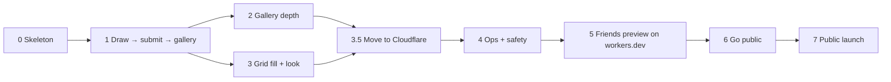

# Solcollab — Implementation Plan

**Status:** Draft v0.1 · 2026-10-16
**Progress:** Phases 0–3 implemented; automated browser verification complete. Physical iPhone frame-rate checks remain · 2026-10-17
**Companion to:** [DESIGN.md](DESIGN.md). Section references (§) point there.

This plan turns the design into eight phases. Each phase ends with something you can **run and look at**, and every phase after Phase 1 leaves the app working. Effort figures are rough focused-work days for one person, there to help with ordering, not as commitments.

**Hosting decision (2026-10-17):** production moves to Cloudflare Workers + D1 + R2 ([HOSTING_CLOUDFLARE.md](HOSTING_CLOUDFLARE.md)). Phases 0–3 were built on Node and are done. **Phase 3.5** ports the server, and Phase 4 onward is built directly on Workers, so the ops features don't get written twice.

---

## Phase 0: Skeleton (≈ 1 day)

**Goal:** an empty app that builds, tests, and runs locally, plus the prompt system, which everything else depends on.

**Tasks**
- [x] `git init`, `.gitignore` (`data/`, `node_modules/`, `.env`), MIT or other license, README with the one-liner.
- [x] npm workspaces: `web/` (Vite + TypeScript) and `server/` (Node 22 + Hono + TypeScript, run with `tsx` in dev).
- [x] Shared tooling: ESLint, Prettier, Vitest, a `tsconfig` base. A `shared/` package for types used on both sides (`Stroke`, `Piece`, API response types).
- [x] `npm run dev` starts Vite (5173) and Hono (8787) together. Vite proxies `/api` and `/img` to Hono.
- [x] Config loader: `.env` → typed config (`PORT`, `DATA_DIR`, `PUBLIC_DOMAIN={{DOMAIN}}`, `STORE_STROKES=true`, `TURNSTILE_*` left empty for now).
- [x] **Prompts** (§4):
  - [x] Starter files `prompts/lewitt.txt`, `prompts/whimsical.txt`, `prompts/architectural.txt`, with 10–20 prompts each (later replaced by `prompts/massmoca.txt`).
  - [x] Parser: comments, blank lines, `# weight:` front-matter, `{slug: …}` overrides, slug generation with `-2` collision handling.
  - [x] Weighted random selection (file, then prompt) with `exclude`.
  - [x] `npm run lint:prompts`: no duplicates, ≤ 140 characters (now 1000), no trailing whitespace.
  - [x] Unit tests for all of the above.
- [x] A GitHub Actions CI workflow running lint, typecheck, test, and build (once there is a remote).

**Exit criteria:** `npm run dev` serves a page showing a random prompt from the files, and refreshing shows a different one. `npm test` passes.

**Completed:** 36 original prompts (12 per file), pinned dependencies and lockfile, local-only dev listeners, and a types-only shared package. The prompt preview excludes the previous instruction via `sessionStorage`; exhausted exclusions fall back to the full catalog. `npm start` also serves the built preview for local verification. The `/` redirect and drawing routes remain in Phase 1 as scoped below. No design decisions changed.

**Verification:** clean `npm ci` on Node 22.23.3; lint, typecheck, all 49 tests, and build passed; npm audit reported zero vulnerabilities. Headless Chromium checks passed against both dev and compiled servers: refresh and button selection, API/image routing, mobile width, retry after an API failure, and disabled storage. CI and Dependabot files are ready; no remote is configured, so hosted CI has not run.

**What's next:** Phase 1 — SQLite and prompt sync, local image storage, the drawing canvas, uploads, and the Newest gallery.

---

## Phase 1: Draw → submit → gallery, end to end (≈ 4–5 days)

**Goal:** the core loop works on localhost, unstyled: get a prompt, draw, submit, and see your drawing among the others.

**1a. Database and storage**
- [x] SQLite via Node 22’s built-in `node:sqlite` (allowed by DESIGN §3.2), WAL pragmas, a tiny migration runner (`server/migrations/001_init.sql`).
- [x] Tables from §5: `walls`, `prompts`, `wall_prompt_counts`, `submissions`, `reports`, `settings`. Seed Wall 1 on first run.
- [x] Sync prompts into the DB at startup (upsert, mark missing ones `active = 0`) and on `SIGHUP`.
- [x] A `Store` interface with `LocalDiskStore` (`data/images/<ulid>/…`, atomic temp-file + rename). `R2Store` comes in Phase 6.

**1b. Canvas** (§2.3)
- [x] 1000×1000 logical canvas with DPR scaling, and two layers (background + ink).
- [x] Pointer Events with coalesced events, `touch-action: none`, pointer capture.
- [x] Stroke model `{color, alpha, size, tool, points: [x, y, pressure, t][]}`. Rendering with perfect-freehand.
- [x] Toolbar: palette + RGBA picker, brush size slider with cursor preview, eraser, undo/redo (keyboard shortcuts too), clear, **background color picker (default white)**, pen input treated like touch (constant width; no pressure toggle).
- [x] Guardrails: Submit disabled until the first stroke, 5,000-point cap, `beforeunload` warning, strokes saved in `sessionStorage`.
- [x] Track the dominant `input_type` (pen/touch/mouse).

**1c. Submit API and pipeline** (§6)
- [x] `POST /api/submissions`: multipart parsing, size limits, `sharp` decode, a 1000×1000 PNG check, flattening onto the background, a blank (uniform color) check, WebP full + thumb.
- [x] Stroke validation with `zod` and a gzip size/decompression cap. Invalid strokes are dropped, not fatal. Skipped entirely when `STORE_STROKES=false`.
- [x] A transaction for the count increment, `number`, `shuffle_key`, and the insert.
- [x] `sharp` concurrency queue (4).
- [x] Anonymous `device_id` cookie, plus `ip_hash` from a daily-rotating salt (use the socket IP locally, and `CF-Connecting-IP` later).
- [x] `GET /img/:key` with immutable cache headers.

**1d. Routes and gallery (Newest only)**
- [x] Client router (History API) for `/draw/:slug`, `/p/:slug`, `/prompts`. `/` redirects to a random prompt on the server.
- [x] `GET /api/prompts/:slug/submissions?sort=new` with keyset pagination.
- [x] Gallery grid with `IntersectionObserver` infinite scroll, lazy thumbnails with explicit sizes.
- [x] `?mine=<id>` pinning (the post-submit page). A **placeholder slot rendered before data arrives** (Grid fill needs this in Phase 3).
- [x] Bottom navigation on all screen sizes: Solcollab at the left, centered outlined **create** SVG (with the `localStorage` exclude list), and a hamburger with Explore prompts / Past walls / About & privacy.
- [x] Submit → plain navigation to the gallery for now (no animation yet).

**Tests:** pagination (keyset edges, the pinned item isn't shown twice), upload pipeline (bad magic bytes, wrong size, a blank image, an oversized file, a malformed strokes file), prompt sync.

**Verification (2026-10-17):** uploads, prompt sync, transaction rollback, atomic writes, validation limits, and pagination are covered by tests. Chromium exercised the full flow and scrolled a 500-fixture gallery. Checkpoint commit: `c2dc21b`.

**What’s next:** deepen gallery browsing and replay (Phase 2), then finish the submit animation (Phase 3).

**Exit criteria:** on localhost you can draw with color, opacity, and a background color, submit, land on the gallery with your drawing pinned first, scroll through 500 seeded drawings smoothly, and hit New prompt / Explore. A seed script (`npm run seed -- --per-prompt 50`) generates random scribbles to test with.

---

## Phase 2: Gallery depth (≈ 3 days)

**Goal:** everything about *looking at* drawings: random order, explore, lightbox, replay, past walls.

- [x] **Random order** (§2.7): bucketed wrap-around cursor `r.<b>.<key>~<id>.<wrapped>` (ID breaks key collisions), a Newest/Random toggle, 🔀 Shuffle again. Tests that a full random pass visits every drawing exactly once.
- [x] **Explore** `/prompts`: counts, a 4-thumb mosaic, sort by active or new, infinite scroll.
- [x] **Lightbox:** full image, name, relative time, "Wall N · Drawing #M", a shareable URL (`/p/:slug#<id>` or `/d/:id`), keyboard navigation (← → Esc), and a **Report** button (wired up in Phase 4).
- [x] **5-second replay** (§2.6): `strokes.json.gz` fetch, the time-compression scheduler (stroke durations proportional, a fixed gap budget, a 16 ms floor, renormalized to exactly 5,000 ms), a rAF renderer that shares the brush code with the editor, play/pause/restart, no autoplay with reduced motion. Hidden when `store_strokes` is off or `strokes_url` is null.
  - [x] Unit test: the schedule always totals 5,000 ms ± 1 frame, for 1 stroke, 1,000 strokes, and a single dot.
  - [x] Visual test: the last replay frame matches `full.webp` (pixel diff under a small threshold).
- [x] **Walls UI:** `/walls` list, `/w/:wall/p/:slug` read-only galleries (no draw button, a "This wall is closed" note), and `GET /api/walls`.
- [x] `GET /api/config`, read by the client at boot (`store_strokes`, `submissions_open`, `current_wall`, `banner_message`).

**Verification (2026-10-17):** fixtures across two walls; random pagination visits all 500 items exactly once including shuffle-key collisions; archived controls are read-only. Chromium, Firefox, and WebKit passed the draw → gallery → lightbox → replay flow. Replay’s final pixels were compared with the stored lossy WebP.

**What’s next:** Grid fill and visual polish (Phase 3).

**Exit criteria:** with seeded data across two walls, you can browse both orders, open any drawing, watch it replay in 5 s, and browse the closed wall read-only.

---

## Phase 3: Grid fill and the look (≈ 5–6 days)

**Goal:** the site looks finished, and the submit moment is delightful.

**3a. UI direction** (§10), ≈ 1.5 days
- [x] Three throwaway HTML mockups of the draw page and gallery: Instruction Card, Graph Paper, Primary Structures.
- [x] **Decision checkpoint:** pick one, or the recommended blend. Record the choice in DESIGN.md §10.
- [x] Design tokens (CSS custom properties: paper, ink, LeWitt primaries, hairline, spacing on an 8 px grid), self-hosted subset fonts, the chosen layout applied to every page.

**3b. Grid fill animation** (§2.5), ≈ 3 days
- [x] `web/src/shatter/`: `types.ts`, `geometry.ts` (Bézier, easing, centroid, shoelace area), `patterns/grid.ts`, `orders.ts` (row-major for v1, plus random and by-ink because they're cheap), `caption.ts`.
- [x] Pattern tests: areas sum to 1, points in bounds, raster no-overlap, same seed → same pieces.
- [x] `engine.ts`: fixed overlay canvas, ImageBitmap snapshot, the Rule → Cut → Lift → Carry → Hang timeline, per-frame destination re-measure, skip on click/tap/key.
- [x] Upload interplay: hold-and-bob while pending (10 s timeout), fall-off-the-wall on failure, return to `/draw` with strokes restored.
- [x] Hang: swap in the real thumbnail, placard ("Wall 1 · Drawing #412 — by you"), geometric confetti.
- [x] Performance fallbacks: 6×6 on low-end devices or narrow screens, skip to Hang when frames drop.
- [x] Reduced motion: rule lines, then a crossfade. `aria-live` announcement.
- [x] Dev harness `/dev/shatter?pattern=&order=&seed=&n=`, with slow motion, scrub, and piece outlines. Built only into dev builds.

**3c. Polish**, ≈ 1 day
- [x] Mobile: bottom bar, a canvas that fits the viewport without page scroll, safe-area insets.
- [x] Accessibility pass: focus order, labels, contrast, keyboard-only drawing tools.
- [x] About page (the LeWitt explanation and privacy; contact section commented out per Rebecca’s instruction).

**Implementation notes (2026-10-17):** selected Instruction Card + subtle Graph Paper, as recommended in DESIGN §10. Three clickable layout studies are saved under `docs/mockups/`. Fonts are served locally with their OFL notices. The shatter engine is shape-independent; the dev-only harness supports seed, density, order, speed, scrub, and outlines. Upload hold/skip/resize, failure restoration, and retry passed browser checks. Reduced motion uses rule lines and a crossfade. Small viewport fitting is measured from the actual instruction and controls.

**Validation remaining:** real iPhone Safari frame-rate measurement. Automated WebKit does not certify iPhone 60 fps. Pen tablets are treated like regular touch, so dedicated tablet validation and pressure tuning are no longer required. The contact email stays blank and its section is commented out until Rebecca provides one.

**Copy follow-up:** decorative taglines and subheadings have been removed. Editorial paragraphs on About, prompt exploration, archived-wall exploration, and the walls index are visible TODOs for Rebecca to write. Drawing instructions, metadata, controls, and operational messages remain functional.

**Final automated verification:** 75 unit/integration tests (two obsolete pressure-curve tests removed after pen input was simplified); lint, typecheck, build, and dependency audit passed (zero reported vulnerabilities). The compiled app passed Chromium, Firefox, and WebKit browser flows, including draft restore, opacity/background rendering, replay image comparison, pinning, sorting, explore, and mobile sizing. Chromium additionally exercised touch input and simulated pen input at different reported pressures, verifying that all new pen points retain constant width. The browser check also confirmed the contact heading and email links are absent; normal-motion checks covered slow uploads, skip, resize, failed uploads, retry, Browser Back, and the 12-second timeout. Production checks confirmed escaped gallery HTML, immutable assets, font license delivery, missing-asset 404s, and absence of the dev harness. Initial JavaScript is approximately 16.2 kB gzipped. Checkpoints: `c2dc21b` (working app) and `ec5aade` (animation and polish), followed by browser lifecycle fixes.

**What’s next:** Phase 3.5, the move to Cloudflare Workers, then Phase 4 operations and moderation built on Workers. Do not expose the app publicly before those controls are implemented.

**Exit criteria:** on iPhone Safari, touch devices, and desktop Chrome/Safari/Firefox, the full loop looks finished and Grid fill runs at 60 fps on the iPhone. The reduced-motion path works.

---

## Phase 3.5: Move to Cloudflare Workers (≈ 3–4 days)

**Goal:** the existing app (Phases 0–3) runs on Workers + D1 + R2, locally in workerd and deployed to staging, with every existing test and browser check passing. No new features. The full mapping and reasoning are in [HOSTING_CLOUDFLARE.md](HOSTING_CLOUDFLARE.md) §5.

**3.5a. Spike first (½ day)**
- [x] jSquash pipeline (`@jsquash/png` decode → flatten → blank check → `@jsquash/webp` encode → `@jsquash/resize` → encode) inside `wrangler dev` on a worst-case noisy 1000×1000 PNG. Record CPU time (target < 1 s) and memory (limit 128 MB).
- [x] **Decision checkpoint:** jSquash, or the Cloudflare Images binding as the encoder. Record it in HOSTING_CLOUDFLARE.md.

**Spike result (2026-10-17):** **jSquash chosen.** Median 94 ms for a typical drawing and 164 ms for the worst case at the upload cap in local workerd (Node CPU cross-check: 101 / 169 ms). Peak memory ~40–50 MB of the 128 MB limit. Bundle 255 KiB gzipped. Typical full WebP is ~137 KB at q90, above the design's estimate; consider q85. Confirmed on Cloudflare in 3.5b: ~205 ms typical, ~550 ms worst case. Details: [`spikes/jsquash/RESULTS.md`](../spikes/jsquash/RESULTS.md). Tooling note: Node 22 + npm were installed via Homebrew (`/opt/homebrew/opt/node@22/bin`, keg-only, so not on `PATH` by default).

**3.5b. Account and resources** (HOSTING §3). Steps involving credentials are Rebecca's.
- [x] Workers Paid (confirmed: spike requests over 10 ms of CPU succeeded), `wrangler login` (account `greenriver`, subdomain `greenriver`).
- [ ] Billing notifications at ~$10 and ~$25 (not yet confirmed).
- [x] D1 `solcollab-staging` / `solcollab-prod`, R2 `solcollab-staging` / `solcollab-prod` / `solcollab-backups` (IDs in HOSTING §2a).
- [ ] Secrets: `IP_HASH_SECRET`, `TURNSTILE_SECRET`. A Turnstile widget. A deploy API token in GitHub secrets.
- [x] Deploy `spikes/jsquash` once and read the per-request CPU time: ~205 ms typical, ~500–550 ms worst case on Cloudflare. All ok. Spike Worker deleted afterwards.

**3.5c. Port the server** (HOSTING §5)
- [x] `server/wrangler.jsonc` with bindings `DB`, `MEDIA`, `ASSETS` (and `BACKUPS` in production), top level = local, plus `staging` / `production` envs. `SUBMIT_RL` comes with Phase 4 rate limiting.
- [x] `server/src/worker.ts` entry point. `createApp({ files })` reads bindings per request (`c.env`).
- [x] Async `Database` wrapper over D1. `insertSubmission` and `syncPrompts` rewritten as `batch()` (atomic), with the per-wall number taken from a subquery (`RETURNING number`).
- [x] Migrations applied via `wrangler d1 migrations apply` (renamed `0001_init.sql`, plus `0002_first_wall.sql` replacing the startup insert). The custom runner and WAL pragmas removed.
- [x] `R2Store` (same key check, content type, immutable cache control). `LocalDiskStore` removed.
- [x] `processImage` on jSquash. `WorkQueue` removed.
- [x] Stroke gzip via `DecompressionStream` / `CompressionStream` with the 2 MB output cap. Stored gzip strokes are served with `encodeBody: 'manual'` (otherwise Workers gzips them a second time).
- [x] Prompts bundled as text modules (`server/src/prompt-files.ts`, checked by `lint:prompts`). They're synced into D1 by the Worker itself whenever the catalog hash differs from `settings.prompts_hash`, so there is no separate `prompts:sync` deploy step.
- [x] `privacy.ts`: secret from `env` (a fixed development-only value locally; uploads are refused in staging/production without it), daily salt via Web Crypto HMAC, client IP from `CF-Connecting-IP`.
- [x] Static assets via Workers Static Assets with `not_found_handling: "none"` (not SPA mode, so missing `/assets/*` files stay 404s). `run_worker_first: ["/"]` for the random redirect. The Worker serves `index.html` for app routes, and server-rendered gallery HTML comes from `env.ASSETS.fetch('/')`. `web/public/_headers` keeps `/assets/*` immutable.
- [x] Removed `@hono/node-server`, `sharp`, `dotenv`, `.env`/`config.ts` file loading, and the Node entry point. `server/.dev.vars.example` for local secrets.

**3.5d. Dev loop, tests, deploys**
- [x] `npm run dev` → Vite (5173) proxying to `wrangler dev` (8787), with local D1/R2 persisted in `server/.wrangler/state`. `npm run seed` writes to the same local D1/R2 through `getPlatformProxy`. `npm start` serves the built app from the Worker.
- [x] Server tests run in Node against fresh in-memory local D1/R2 from Wrangler's **`getPlatformProxy`**. `@cloudflare/vitest-pool-workers` was not used because it requires Vitest 4 and the repo is on Vitest 5. Browser and animation checks pointed at the local Worker.
- [ ] GitHub Actions: CI → deploy staging on push to `main` (migrations → `wrangler deploy` → smoke test). A manual "Deploy production" workflow. *Blocked: no GitHub remote yet.* `npm run deploy:staging -w server` / `deploy:production` work from the Mac mini in the meantime.
- [x] First staging deploy and smoke test: `https://solcollab-staging.greenriver.workers.dev`. Migrations applied, one test upload end to end (0.85 s), images and replay served from R2.
- [x] **Staging is private behind a site password** (`SITE_PASSWORD` secret, user `solcollab`, with `REQUIRE_SITE_PASSWORD=true` failing closed, and `run_worker_first: true` so static files are gated too). One-click Cloudflare Access was tried first. It showed a sign-in page in Rebecca's browser, but anonymous requests from the Mac mini still reached the app, so it wasn't relied on. Verified 2026-10-17: anonymous and wrong-password requests get 401 on every page, API, image, asset, and upload route. `/healthz` is the only open path. Per-version preview URLs are off (`preview_urls: false`).
- [ ] Practice a **D1 Time Travel restore** on staging and a `wrangler rollback`.

**Verification (2026-10-17):** `npm run lint` (ESLint and prompt lint), typecheck, **78 unit/integration tests** (on local D1/R2), `npm run build` (web + production Worker dry-run bundle: 1.6 MiB / 404 KiB gzipped), and `npm audit` (0 vulnerabilities, after pinning Miniflare's optional `sharp` to 0.35.5 with an npm override) all pass. Chromium browser flows pass through Vite + Worker **and** against the Worker serving the built assets directly. Animation checks pass through Vite. Firefox/WebKit weren't re-run: Playwright 1.62.1's browser builds aren't installed on this Mac (`npx playwright install` needed). Two browser-check expectations were stale from the toolbar redesign (`e02724b`, `9ccf078`) and were updated: 15 tool cells, and a "Submit" button. Prettier flags two untracked files that aren't part of this work (`.claude/launch.json`, `docs/MODERATION_OPTIONS.md`).

**Exit criteria:** all unit/integration tests and the Chromium/Firefox/WebKit browser flows pass against local workerd. Staging on `workers.dev` passes the smoke test and a manual draw → Grid fill → gallery → replay run on a phone. The jSquash CPU measurement is recorded. No Node server remains in the repo. *Status: everything local is met (Chromium only). The staging deploy and the phone run remain.*

---

## Phase 4: Ops and safety on Workers (≈ 3–4 days)

**Goal:** every control in §8 exists and has been exercised, *before* anyone outside sees the site. Built directly on Workers (HOSTING §10).

- [ ] **Settings switches** (§8.1): `submissions_open`, `read_only`, `global_daily_cap`, `banner_message`, per-prompt `accepting`, optional `open_from/open_until`. Cached per isolate for ≤ 5 s. The UI reacts (closed-wall message, banner).
- [ ] **App rate limits** (§8.2): the `SUBMIT_RL` binding for the short windows (per IP hash and per device), **D1-counted** hourly and daily caps (global, since the binding counts per location), a per-prompt flood guard, and a 429 with `Retry-After` that the client shows politely.
- [ ] **Display-name filtering:** Unicode NFKC, strip zero-width and bidi-override characters, ≤ 32 characters, the `obscenity` matcher.
- [ ] **Turnstile:** client widget plus `siteverify` from the Worker, behind a flag (off locally and in tests, on in staging and production).
- [ ] **Reports and moderation** (§8.3): report endpoint (one per device), auto-hide at the threshold, and a "report submitted" confirmation. See also `docs/MODERATION_OPTIONS.md`.
- [ ] **Admin UI** `/admin` + `/api/admin/*` in the same Worker: review queue (restore/hide/delete/ban), switches, stats (submissions per minute, top prompts, 429 counts). **Cloudflare Access** in front, with `Cf-Access-Jwt-Assertion` verification in code. (Locally: a dev-only bypass flag.)
- [ ] **Ops CLI** `scripts/ops.ts` calling the admin API with an Access service token and `--env local|staging|production`: `close-submissions`, `open-submissions`, `close-prompt`, `purge --prompt/--since/--ip-hash/--device`, `new-wall [--title] [--prompts]`, `export-wall`, `purge-strokes`, `gc`.
- [ ] **Cache-purge hook:** an interface called on hide, delete, and new-wall. A no-op until the custom domain exists; the Cloudflare purge-by-URL implementation comes in Phase 6.
- [ ] **Cron** (`scheduled` handler): nightly `gc` (soft-deleted rows plus R2 objects > 30 days), orphaned R2 cleanup, scheduled wall windows, and a submission-spike alert.
- [ ] **Backups:** D1 Time Travel (automatic) plus a weekly GitHub Action that runs `wrangler d1 export` into `solcollab-backups`, keeping 12 weeks. **Practice a restore into staging.**
- [ ] **Observability:** structured JSON `console.log` to Workers Logs, `/healthz`.
- [ ] Security headers: CSP, `nosniff`, `frame-ancestors 'none'`, `Referrer-Policy`.

**Exit criteria:** a written "ops drill" passes on staging. Close submissions → the UI shows closed. Spam 50 submissions from one device → rate limited. Report a drawing 3× → hidden. Restore it from admin. Run `new-wall` → Wall 2 is empty and Wall 1 is read-only in `/walls`. Rewind staging D1 with Time Travel → data restored.

---

## Phase 5: Friends preview on `workers.dev` (≈ 1 day + a week of use)

**Goal:** production runs on Cloudflare at `solcollab.<account>.workers.dev`, **invite-only**, and a few trusted people use it (HOSTING §8). Nothing on the Mac mini is exposed.

- [ ] Deploy production with the manual workflow.
- [ ] Enable **Cloudflare Access** on the production `workers.dev` hostname, with an email allow-list (friends sign in with an emailed one-time code).
- [ ] Turnstile on, rate limits on, `global_daily_cap` around 500.
- [ ] Watch Workers Logs, the admin stats, and the billing page for a week. Tune the rate limits and the Grid fill timing from real use.
- [ ] Measure real iPhone Safari frame rate for Grid fill (still open from Phase 3).
- [x] Pen-input decision: use regular touch behavior; no pressure tuning or dedicated tablet testing (2026-10-17).

**Exit criteria:** a week of friends-only use with no data loss, no surprises on the bill, and no unresolved bugs marked "must fix".

---

## Phase 6: Go public at `twolinescrossing.art` (≈ 1–2 days, when we decide to)

**Goal:** public on the planned domain, ready for an HN-sized spike (HOSTING §9). **This phase starts only when we decide to go public. Until then the domain stays a placeholder.**

- [ ] Register `twolinescrossing.art` (Cloudflare Registrar if it offers `.art`, otherwise Porkbun with nameservers on Cloudflare). Zone on the Free plan.
- [ ] Attach the Worker as a Custom Domain (`www` → redirect). Set `PUBLIC_DOMAIN`.
- [ ] R2 custom domain `img.twolinescrossing.art` + a Cache Rule (respecting the origin's immutable headers). Image URLs switched to it. CSP updated.
- [ ] **Cache API** wrapping of the cacheable gallery and prompt GETs in the Worker (no-op on `workers.dev`, active here).
- [ ] Zone security: WAF managed rules, Bot Fight Mode, a rate-limiting rule on `POST /api/submissions`, and a **pre-made, disabled "block all POST" kill-switch rule**. Write down how to flip it.
- [ ] Access: remove the friends-only policy from the main hostname; keep it on `/admin*` and `/api/admin/*`.
- [ ] Turnstile widget: add the domain. `CF_PURGE_TOKEN` (Zone → Cache Purge only) and the purge-by-URL implementation behind the Phase 4 hook.
- [ ] An uptime monitor on `/healthz` through the public hostname.
- [ ] **Load test** with k6 from the Mac mini: 200 rps of gallery reads (both orders) + 10 rps of uploads for 10 minutes. Then purge the test drawings.

**Exit criteria:** the load test shows < 1% errors, a > 90% cache hit rate on images and gallery JSON, and a p95 upload under 1.5 s. The kill switch has been tested. The bill estimate for the test is within expectations.

---

## Phase 7: Public launch (≈ 1 day + watching)

- [ ] Seed each prompt on Wall 1 with a few real drawings (from friends), so no gallery is empty.
- [ ] Final copy for the About page, the privacy note, and a takedown contact address.
- [ ] Open Graph images per prompt (a mosaic) so shared links look good.
- [ ] Launch-day runbook: who watches the admin queue, rate-limit values to tighten under load, when to flip the kill switch, a banner message ready to go.
- [ ] Post it, and watch the stats.

---

## Cross-cutting rules for every phase

- **No AI judging, scoring, or generation** of drawings, ever (DESIGN §1). An optional safety flagger may only queue drawings for human review.
- **No user-submitted prompts.** Prompts come only from `prompts/*.txt`.
- Each phase ends with tests passing, DESIGN.md updated if a decision changed, and a short "what's next" note in this file.

## Deferred / later
- More shatter patterns (bands, triangles, four directions, arcs, hexagons, shards, jigsaw), chosen at random per submission with a stored seed (§2.5.5).
- No pen-pressure tuning or calibration is planned; styluses use the regular touch behavior.
- Rendering images on the server from strokes instead of accepting PNG uploads (§2.6.4).
- A Node/VPS adapter behind the `Store` and `Database` interfaces, only if we ever leave Cloudflare (HOSTING §12).
