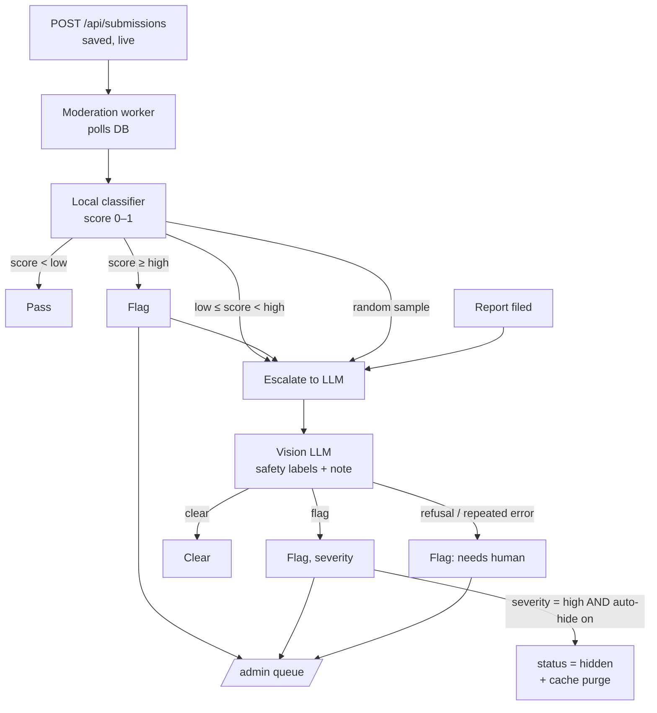

# AI image moderation: implementation plan

Status: **draft for review**. Background and the other options are in [MODERATION_OPTIONS.md](MODERATION_OPTIONS.md).

**Chosen approach:** a local classifier checks every submission. A vision LLM checks only the drawings the local model is unsure about, drawings that get reported, and a small random sample. Cloudflare CSAM scanning runs in front of everything (Option E). It is a dashboard setting, not code, but it is on the launch checklist below.

## Goals and non-goals

- **Goal:** get likely-inappropriate drawings in front of a human quickly, with labels and a short reason, at near-zero cost per submission.
- **Goal:** the LLM sees as few drawings as possible, and never any personal data.
- **Non-goal:** blocking uploads. Submissions are accepted and go live as they do now (§8.3). Moderation runs **after** the drawing is saved.
- **Non-goal (permanent, §1):** any quality, relevance, or "on-prompt" judgment. Moderation produces safety labels only, and gallery, ordering, and public API code never read them.

## Depends on

Phase 4 in `docs/IMPLEMENTATION_PLAN.md` (reports, auto-hide, `/admin` queue) is not built yet. Steps 1–4 below can be built and tested on their own. Step 5 plugs into the report endpoint and admin queue, so it lands with or after Phase 4.

## How it works



### Decision rules (in our code, not the model's)

| Situation | Result |
|---|---|
| Local score `< moderation_local_low` | Pass. No LLM call unless the drawing is in the random sample. |
| Local score in `[low, high)` | Escalate to LLM. |
| Local score `≥ moderation_local_high` | Flag at once (category `sexual`, severity `medium`), then escalate to LLM for categories and a note. |
| Random sample (`moderation_sample_rate`, e.g. 0.02) | Escalate to LLM whatever the local score. This is how we measure what the local model misses (text, symbols). |
| First report on a drawing that has no LLM check yet | Escalate to LLM. |
| LLM returns `flag: true` | Flag with the LLM's categories, severity, and note. |
| LLM returns `flag: false` | Clear. If the local model had flagged it, the flag stays in the queue, marked "LLM disagreed", for a human to decide. |
| LLM `stop_reason: "refusal"` | Flag as `needs_human`. A refusal on a moderation image is itself a signal. |
| LLM error, after 3 retries with backoff | Flag as `needs_human` with the error. |
| LLM disabled or no API key | Escalations become `needs_human` flags right away. |
| An admin restores or confirms a drawing | Record `reviewed_at`. Later automated checks on it don't re-flag it. |

**Auto-hide** is behind the setting `moderation_auto_hide` (`off` | `high`), **default `off`**. With `off`, behavior matches §8.3 as written: flag only. Turning on `high` hides LLM-flagged drawings with `severity = high`, using the same path as report auto-hide (reversible, purges the cache). It needs the §8.3 amendment in step 6.

## Steps

### Step 0: Test set and model selection

Do this before writing production code. The local model and the thresholds come out of it.

- `scripts/moderation-eval/` (local only, **gitignored**): around 150 PNGs drawn with our own canvas:
  - ~100 ordinary drawings: grids, arcs, dense hatching, skin-tone and red fills, LeWitt-style shapes.
  - ~50 deliberately bad ones we draw ourselves: crude nudity, swastikas and other hate symbols, written slurs, gore.
  - Never collect or create CSAM test material. That category is covered only by Cloudflare's hash matching.
- `scripts/moderation-eval.ts`: runs each candidate local model and the LLM prompt over the set, and prints per-category false positives and misses plus latency.
- Pick:
  - **Local model:** compare 2–3 ONNX NSFW classifiers, including at least one trained on illustrated/anime content as well as photos. Check each license allows commercial use.
  - **Thresholds:** `low` such that local passes miss nearly no bad drawings that the local model *can* see (sexual content); `high` such that almost nothing ordinary scores above it.
  - **LLM prompt:** iterate `server/src/moderation/policy.md` until ordinary grids and lines aren't flagged as symbols.
  - **LLM model:** run the final prompt with `claude-haiku-5-5` and `claude-opus-5-5`, with the same schema and effort. Compare misses, false positives, latency, and cost per call. Keep Haiku unless Opus catches meaningfully more of the bad set.
- **Exit:** chosen model file plus its SHA-256, the two thresholds, the Haiku-vs-Opus result, and the measured miss rate for text/symbols with LLM sampling only (this sets `moderation_sample_rate`).

### Step 1: Schema and settings

`server/migrations/002_moderation.sql`:

```sql
CREATE TABLE moderation_checks (
  submission_id TEXT NOT NULL REFERENCES submissions(id),
  provider TEXT NOT NULL,            -- 'local' | 'llm'
  model TEXT NOT NULL,               -- e.g. model file hash, or 'claude-haiku-5-5'
  reason TEXT NOT NULL,              -- 'all' | 'uncertain' | 'local_high' | 'sample' | 'report'
  state TEXT NOT NULL,               -- 'pending' | 'done' | 'error'
  attempts INTEGER NOT NULL DEFAULT 0,
  score REAL,                        -- local only
  flagged INTEGER,
  categories TEXT,                   -- JSON array of safety labels
  severity TEXT,                     -- 'low' | 'medium' | 'high' | 'needs_human'
  note TEXT,
  error TEXT,
  created_at INTEGER NOT NULL,
  updated_at INTEGER NOT NULL,
  PRIMARY KEY (submission_id, provider)
);
CREATE INDEX idx_mod_pending ON moderation_checks(state, provider, updated_at);
ALTER TABLE submissions ADD COLUMN flagged INTEGER NOT NULL DEFAULT 0;
ALTER TABLE submissions ADD COLUMN reviewed_at INTEGER;
INSERT INTO settings VALUES
  ('moderation_enabled', 'true'),
  ('moderation_llm_enabled', 'true'),
  ('moderation_auto_hide', 'off'),
  ('moderation_local_low', '0.2'),     -- placeholders until step 0
  ('moderation_local_high', '0.85'),
  ('moderation_sample_rate', '0.02');
```

- `submissions.flagged` is a denormalized bit for the admin queue query. Only moderation code and admin code write or read it.
- `Database` helpers in `server/src/db/index.ts`: `pendingLocal(limit)`, `pendingLlm(limit)`, `recordCheck(...)`, `setFlag(id, ...)`.
- **Tests:** the migration applies on a fresh DB and on a DB that already has submissions.

### Step 2: Local classifier

`server/src/moderation/local.ts`:

- Dependency: `onnxruntime-node`, pinned.
- The model file lives at `data/models/<name>.onnx`. It is not committed. `npm run ops -- fetch-moderation-model` downloads it and checks the SHA-256 from step 0. Config: `MODERATION_MODEL_PATH`.
- Load the session once at startup. If the file is missing or the hash doesn't match, log a warning and leave local moderation off, so the server still starts.
- `classify(webp: Uint8Array): Promise<number>`: decode with `sharp`, resize to the model's input size (typically 224×224), normalize, run, and return the probability of the unsafe class(es), combined into one score.
- Input is the stored `full.webp`, which the server already flattened (§ "What we're checking" in the options doc). We never trust anything the client says about its own image.
- **Tests:** a tiny stub model (or a mocked session) for the plumbing. One real-model smoke test, skipped when the model file is absent.

### Step 3: LLM check

`server/src/moderation/llm.ts`, using `@anthropic-ai/sdk`:

- **Model:** config `MODERATION_LLM_MODEL`, default `claude-haiku-5-5` (decision 1 below).
- **Input:** `full.webp` resized to 512×512 with `sharp`, sent as a base64 `image` block (`media_type: "image/webp"`), plus the prompt text. Never the display name, device ID, IP hash, or submission ID.
- **System prompt:** `server/src/moderation/policy.md`, versioned in the repo. It lists the categories and says the model judges safety only, never quality or relevance.
- **Structured output:** `output_config.format` with a JSON schema, read with the SDK's `client.messages.parse()` helper:

  ```json
  {
    "type": "object",
    "additionalProperties": false,
    "required": ["flag", "categories", "severity", "note"],
    "properties": {
      "flag": { "type": "boolean" },
      "categories": {
        "type": "array",
        "items": { "enum": ["sexual", "violence_gore", "self_harm", "hate_symbol", "hateful_text", "harassment_text", "personal_info", "other"] }
      },
      "severity": { "enum": ["none", "low", "medium", "high"] },
      "note": { "type": "string", "maxLength": 200 }
    }
  }
  ```

- **Request settings:** `output_config.effort: "low"` (a classification route; confirm in step 0 that `low` holds accuracy). `max_tokens` ~2000, since thinking counts against it. Client `timeout` 30 s, `maxRetries` 2.
- **Results:** check `stop_reason` before reading content. `refusal` means `needs_human`. `max_tokens` means retry once, then `error`. Handle typed SDK errors: `RateLimitError` and 5xx back off; `BadRequestError` and `AuthenticationError` go straight to `error` and are logged loudly.
- **Cost estimate** (Haiku 5.5 is $0.10 / $0.50 per million input/output tokens; recheck before launch): a 512×512 image is ~350 tokens, plus ~700 tokens of prompt, plus ~300 output tokens including thinking. That is about **$0.25 per 1,000 escalations**. With 2% sampling, ~15% uncertain, and reports, that is ~20% of submissions, or **≈ $0.05 per 1,000 submissions**.
- **Tests:** a mocked client for each branch: flag, clear, refusal, `max_tokens`, 429, 400, and malformed output.

### Step 4: Worker and policy

`server/src/moderation/worker.ts`, started from `server/src/index.ts`:

- **Restart-safe by design:** no in-memory job list. Every few seconds the worker:
  1. Finds submissions with no `local` check row and runs the local classifier on them (in batches, through the existing `WorkQueue`, so image work stays bounded).
  2. Finds `llm` rows with `state = 'pending'` (or `error` with `attempts < 3`, after backoff) and runs them, at most 2 at a time.
- `server/src/moderation/policy.ts` holds the decision table above as a **pure function**: `(local, llm, settings, reviewed) → { flag, severity, hide, escalate }`. The worker only does I/O.
- `submissions_open` / `read_only` don't stop moderation. `moderation_enabled = false` pauses the worker, and turning it back on catches up on the backlog.
- `POST /api/submissions` is **unchanged**: the worker finds new rows by itself, so upload latency stays the same.
- **Tests:** an exhaustive table test for `policy.ts`; a worker test with fake classifier and LLM covering a restart mid-batch, retries, and auto-hide on/off.

### Step 5: Hook into reports, admin, and ops (with Phase 4)

- **Report endpoint:** on a drawing's first report, insert a pending `llm` row with `reason = 'report'` if none exists.
- **Admin queue:** list `reported OR flagged`, unreviewed first. Each row shows the labels, severity, the LLM note, the local score, and "LLM disagreed" where it applies. Restore and Hide set `reviewed_at`.
- **`/admin/stats`:** flags per day by source; LLM calls per day and estimated cost; **sample misses** (the LLM flagged a drawing the local model passed), which is the main signal for retuning thresholds or `sample_rate`.
- **Ops CLI:** `npm run ops -- moderation rescan --since <date> [--llm]` (after a model or threshold change) and `npm run ops -- moderation status`.
- **Alert:** an ntfy push when `severity = high` flags exceed N in an hour (§8.7).

### Step 6: Docs and guardrails

- `docs/DESIGN.md` §8.3: replace the "future option" bullet with this design. Auto-hide ships off, so "must never block" stands. Amend it only if `moderation_auto_hide = high` is turned on later.
- §1 guardrail test: a test that fails if `gallery.ts` or any public route imports from `server/src/moderation/` or mentions `flagged`, `moderation_checks`, or `severity`.
- Privacy text on `/about`: drawings may be checked automatically for safety, and some are sent, without any personal data, to an AI provider for that check.
- `.env.example`: `ANTHROPIC_API_KEY`, `MODERATION_LLM_MODEL`, `MODERATION_MODEL_PATH`.
- `docs/IMPLEMENTATION_PLAN.md`: add these steps under Phase 4.

### Launch checklist (not code)

- [ ] Cloudflare CSAM Scanning Tool turned on for the image hostname; NCMEC reporting steps in the runbook.
- [ ] Model file fetched on the Mac mini, hash verified, startup log shows local moderation on.
- [ ] `ANTHROPIC_API_KEY` set for the `_solcollab` user only; a spend limit set on the API workspace.
- [ ] Ops drill extended: submit a crude test drawing, and it appears in `/admin` flagged with a note within a minute.

## Decisions

1. **LLM model — decided:** default `claude-haiku-5-5`. Step 0 runs `claude-opus-5-5` on the same test set. Switch the default only if Opus is clearly better on drawings (it costs ~40× as much, which is still only cents per thousand submissions at this volume).
2. **Auto-hide — decided:** ships `off` (flag only), so §8.3's "must never block" stays as written for now. Reconsider `high` if the review queue gets busy. That would need the §8.3 amendment.
3. **Sample rate — open:** 2% is a placeholder until step 0 measures how often the local model misses text and symbols.

## Out of scope

- OCR (Option D). The LLM sample and reports cover written text for now. Revisit if sample misses show a lot of text.
- Rasterizing drawings from strokes on the server (DESIGN §2.6 future option). That's separate, though it would let us moderate exactly what the replay shows.
- Moderating display names. Already planned with `obscenity` in §8.2.
